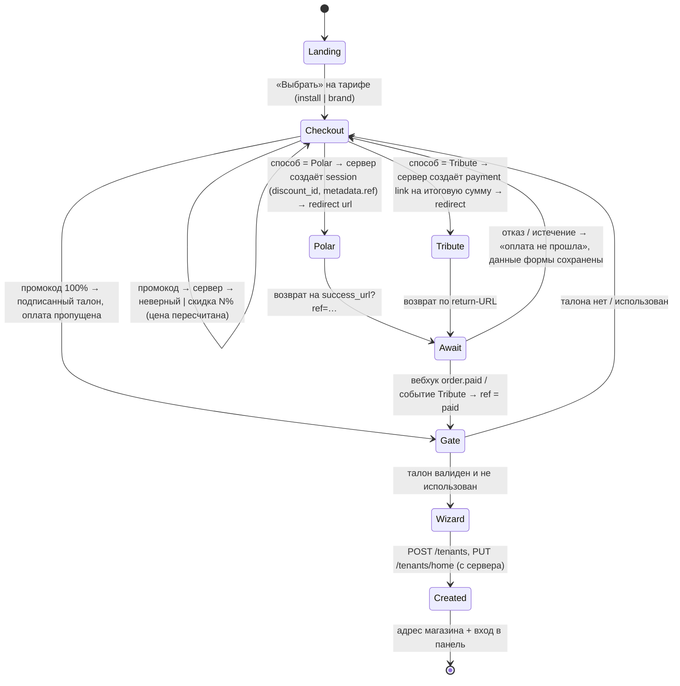

# Главная upready.dev → воронка «тариф → оплата → онбординг»: объём, декомпозиция, модели, варианты

Дата: 2026-09-12 23:20 WITA · ветка `feature/homepage` · автор: сессия-скоупер (Fable 5.1) по директиве Ивана
`artifacts/prompts/2026-09-12-ivan-directive-homepage-funnel.md`.
Статус: **представление об объёме (п. 5 директивы)**. Реализация (п. 1–4) не начата: ждём детали стека и выбор варианта.

## 0. Что есть на входе (измерено, не по памяти)

| Что | Где | Факт |
|---|---|---|
| Текущая страница | `apps/homepage/index.html` (161 КБ, ~1500 строк, все стили инлайн) + `support.js` (69 КБ, рантайм: React/Babel с unpkg, шаблоны `{{ }}`) | Два тарифа: `install` 4 900 ₽ (установка, 24 ч, возврат 7 дней), `brand` 9 900 ₽ (оформление, +48 ч, без возврата). CTA «Перейти к оплате в Tribute» → `https://t.me/tribute?tg=<handle>`; текст «оплата картой или через СБП на стороне Tribute». Промокодов, Polar и онбординга на странице нет. |
| Существующий UI онбординга | ветка `feat/mt-deploy` (коммит `3c1e8bc`), `apps/storefront/src/app/start/` — на `dev` его НЕТ | Next.js: `page.tsx` 70 (четыре формы воронки), `pay/pay-form.tsx` 205 (тестовая касса), `onboarding/wizard.tsx` 371 (поля: название, handle, email владельца, пресет темы, светлый/тёмный), `demo.module.css` 554, `api/demo/onboarding/route.ts` 205 (сервер → Medusa `/auth/tenant/emailpass/register` → `POST /tenants` → `PUT /tenants/home`; у `/tenants/*` нет CORS — только с сервера). |
| Дизайн-система | `~/upready/projects/design-docs/design-systems/medusa-ui/` | 328 React-компонентов (JSX + d.ts), 264 CSS-токена (`tokens/fig-tokens.css`, тёмная тема под `[data-theme="dark"]`), Inter 13px, zinc, единственный акцент blue-500 `#3B82F6`, «shiny» кнопки, sentence case, без эмодзи. Страница уже zinc/Inter 13–13.5px, но акцент `#2563EB` (blue-600) — расхождение в один тон. |
| Эталон стека | envoicer `…/final` | React Router 7.16 (`ssr: true`) + Vite + Cloudflare Workers (`@cloudflare/vite-plugin`, wrangler), React 19.2, Tailwind 4, shadcn/radix, zod + react-hook-form, vitest; e2e-сьюта нет (только `tests/manual/*.mjs`). **Polar уже интегрирован**: `api.checkout.ts` (71 строка, `polar.checkouts.create`), `api.polar-webhook.ts` (97 строк, `validateEvent`). |
| Polar (docs, 12.09) | polar.sh/docs | Checkout session: `products[]`, `discount_id`, `allow_discount_codes`, `success_url`, `metadata` (≤50 пар), `customer_email`, `external_customer_id`; ответ содержит `url` и `is_payment_required` (false при нулевой сумме). Скидки: % или фикс, на конкретные продукты, лимиты погашений. Вебхуки: `checkout.created/updated/expired`, `order.created/paid/updated`; для разовой покупки — `order.paid`. |
| Tribute (docs, 12.09) | wiki.tribute.tg | Telegram-платформа для авторов, комиссия 10%, карты любого банка + крипта, API с заголовком `Api-Key`. В индексе документации есть страницы Webhooks, **Payment Links (for-shops/api)**, Digital products, Promo codes — но промокоды описаны только для подписок. Поля вебхука разовой оплаты, метаданные и return-URL — **не прочитаны** (WP0). |

## 1. Схема взаимодействия — черновик v0 (финализируется в WP1 вместе с макетами)

Инварианты, которые схема обязана держать (проверяются тестами WP7):

1. **Онбординг открывается только по талону** — оплаченный `ref` или 100%-промокод; талон подписан сервером, одноразовый.
2. **Вебхук — единственный источник «оплачено»**; возврат на success_url без вебхука = экран ожидания (опрос 2–3 мин, затем «напишем в телеграм»), не доступ.
3. **Идемпотентность**: повтор вебхука, двойной возврат, повторное погашение талона — без второго магазина и без второго «оплачено».
4. **Промокод привязан к тарифам**: карта `код → {тариф: скидка}`; на тариф вне карты цена не меняется, пользователь это видит.
5. **Скидка считается у нас**, провайдер получает итоговую сумму (Polar — через `discount_id`, Tribute — суммой ссылки); 100% не ходит ни к какому провайдеру.
6. Ошибка создания магазина (занят handle) возвращает в мастер с сохранёнными полями, талон не сгорает.

Сценарии для автотестов (12): install→Polar→оплачено→магазин · brand→Polar · install→Tribute · неверный промокод · промокод 50% только на install (brand без скидки) · промокод 100%→онбординг без оплаты · повторное погашение 100% отклонено · возврат раньше вебхука→ожидание→вебхук→проход · отказ/истечение→назад с сообщением · онбординг без талона заблокирован · вебхук с неверной подписью→401 без изменений · коллизия handle→форма сохранена.

## 2. Декомпозиция

Сложность: S ≈ до 0,5 машино-дня · M ≈ 0,5–1 · L ≈ 1–2. Модель — по правилу 5e: суждение/вкус/инварианты — Fable, механика по спеке — Sonnet 5.

| WP | Содержание | Сложн. | Модель | Зависит от | Приёмка |
|---|---|---|---|---|---|
| WP0 | Разведка: Tribute payment links + вебхуки + промо для разовых продуктов (прочитать 3 страницы wiki); Polar sandbox, валюты и приём российских карт; выбор рантайма и хранилища заказов/талонов | S | Fable (решения), Sonnet (чтение) | **детали стека от Ивана** | таблица фактов с цитатами |
| WP1 | Дизайн-этап (27d): финальная схема состояний + HTML-макеты 4 экранов на токенах Medusa UI (выбор тарифа, оформление с промокодом, ожидание подтверждения, мастер онбординга) — **Иван смотрит глазами до кода** | M | Fable | WP0 | Иван: «согласовано» по каждому экрану |
| WP2 | Каркас RR7 в `apps/homepage` (Vite, TS, `routes.ts`, адаптер по стеку) + перенос статического лендинга в React-компоненты с токенами вместо инлайн-стилей; `support.js` уходит | L | Sonnet | стек | пиксельная сверка со старой страницей на 3 ширинах, 0 ошибок консоли |
| WP3 | Мост дизайн-системы: `fig-tokens.css` + отобранные компоненты (Button, TextInput, Radio, Badge, Alert, Toast, Modal, ProgressTabs, Spinner) как локальный пакет; решение по акценту (#2563EB ↔ blue-500) | M | Sonnet, ревью Fable | WP1 | витрина компонентов в светлой и тёмной теме |
| WP4 | UI воронки: выбор тарифа → экран оформления (промокод, пересчёт, выбор провайдера) → экран ожидания | M | Sonnet | WP1, WP3 | макет = экран (по кадрам), e2e из WP7 |
| WP5 | Платёжный бэкенд: Polar (перенос из envoicer: session + `order.paid`), Tribute (новое: payment link + вебхук), реестр промокодов, валидация, подписанный талон, хранилище заказов/талонов, идемпотентность | L | Sonnet; инварианты 1–5 — Fable | WP0, стек | vitest + песочница провайдера |
| WP6 | Перенос онбординга: `wizard.tsx` → маршрут RR7 на Medusa UI (поля и логика те же), серверный вызов Medusa `/tenants` | M | Sonnet | WP3, WP5 (талон) | магазин создан на стенде, вход в панель |
| WP7 | Тесты: vitest (промо-математика, талон, подпись вебхуков) + Playwright e2e по 12 сценариям; сьюта запускается одной командой | L | Sonnet | WP4–6 | зелёный прогон в CI-подобном запуске |
| WP8 | Приёмка на экземпляре, который открывает Иван (18f): проход всех воронок браузером, журнал приёмки в `artifacts/docs/`, HANDOFF | M | Fable-приёмщик + Иван | WP7 | Иван принял |

Критический путь: WP0 → WP1 → WP3 → WP4 → WP7 → WP8; параллельно ему идут WP2 и WP5 (оба зависят только от стека).

## 3. Оценка объёма

Канон — стор `@upready/estimation` (правило 18g), две записи:
`est-homepage-funnel-solo-2026-09-12` и `est-homepage-funnel-orch-2026-09-12`
(`node ~/upready/packages/@upready/estimation/bin/estimate.mjs render <id>` — токены по полосам, стоимость min/max/mean/median).

| Вариант | Ходы (main) | Машинное время | Календарь | Гейты |
|---|---|---|---|---|
| A · соло Fable | 150–400 | 8–24 ч | 3–6 дней | 5 |
| C · архитектор Fable → 1 воркер Sonnet → приёмщик Fable | 60–140 (+150–400 у воркера) | 10–27 ч | 3–5 дней | 6 |

Стоимость по ценам API (сумма in+кэш+out, min / max / медиана; `render` от 2026-09-12 23:20 WITA): A — $45.60 / $151.80 / $98.70 · C — $35.66 / $109.50 / $72.58. На подписке это прокси-метрика расхода, не счёт.

Метод: декомпозиция ×аналогия с принятой оценкой `est-mt-tenant-panel-minimal-2026-09-11` (панель тенанта, принята живьём), масштаб ×3–4. Самая широкая полоса — перенос лендинга (1500 строк инлайн-стилей) и Tribute (API не прочитан).

## 4. Модели

- **Fable 5.1**: схема состояний и инварианты, макеты, брифы, ревью платёжных инвариантов, приёмка. Здесь цена ошибки — двойной магазин или бесплатный доступ, это работа суждения.
- **Sonnet 5**: перенос лендинга, мост DS, UI по макетам, перенос мастера, тесты — механика по написанной спеке с внешней проверкой (кадры, e2e).
- **Haiku 4.5**: не нужен — нет батчей однотипных единиц ≥5 (правило 19a/22b).

## 5. Варианты исполнения

| | Плюсы | Минусы | Когда брать |
|---|---|---|---|
| **A. Соло** (Fable, одна сессия) | максимальная когерентность UI, ноль потерь на передаче | 161 КБ лендинга проходит через окно Fable (25a); Иван без отзывчивой сессии 3–6 дней; приёмка «своими глазами» — по отчёту самому себе (18f нарушается по духу) | если стек придёт сегодня и нужен один ответственный |
| **B. Соло-гибрид** (Fable = дизайн/спека/инварианты; фоновый Sonnet = WP2/WP6/WP7 по спеке; правило 5e, `feedback_delegate_downtier_mechanics`) | main на связи, механика на дешёвом tier, без оркестратора | приёмщик всё равно нужен отдельно; два дерева — конфликты правок в `apps/homepage` | если Иван хочет держать эту сессию как единственную точку входа |
| **C. Архитектор → 1 воркер → приёмщик** (образец ночи 3 `feat/mt-deploy`: одна сессия пишет спеку и брифы, один Sonnet-воркер в Superset-workspace на task-ветке (21k), отдельная сессия-приёмщик на живом стенде) | «один воркер вместо трёх» — решение Ивана 12.09; приёмщик не читал отчёт воркера; коммиты по WP на своей ветке, PR на приёмку | +1 гейт (ок на оркестрацию, 3b); каждый WP требует брифа на английском (3a) | **рекомендую**: п. 4 директивы уже требует внешней приёмки |
| **D. Полная оркестрация** (N воркеров по WP параллельно) | календарь короче на ~1 день | цепочка почти последовательная (дизайн → мост → UI → тесты), параллельны только WP2 ∥ WP5; +30–50 % токенов за координацию; риск разъезда стиля между воркерами — ровно то, что п. 2.2 запрещает | не рекомендую |

**Рекомендация: C.** Эта сессия остаётся архитектором (WP0-решения, WP1 макеты, брифы, ревью WP5), воркер — Sonnet 5 в workspace, приёмщик — отдельная Fable-сессия либо Иван напрямую. Запасной — B, если Иван не хочет второй сессии.

## 6. Что нужно от Ивана (гейты) и решения, принятые молча

Нужно от Ивана:
1. **Детали стека** (обещаны): рантайм (Workers как envoicer или Node), хранилище для заказов/промокодов/талонов (KV/D1, Supabase, Postgres Medusa) — без этого WP5 и WP2 не стартуют.
2. **Выбор варианта** A/B/C (для C — явный ок на оркестрацию, правило 3b).
3. **Ключи**: Polar sandbox token, Tribute API key (или указание, что Tribute остаётся ссылкой в телеграм, как сейчас).
4. **Кто администрирует промокоды**: файл/таблица без UI (YAGNI, 32a) или экран в панели — по умолчанию файл/таблица.
5. **Куда создаёт магазин онбординг на приёмке**: живой движок (каждый проход = настоящий тенант и поддомен, `q-demo-tenants-cleanup`) или стенд.

Принято молча (правило 22c, обратимо):
- Дизайн-система для этой поверхности — **Medusa UI** по слову Ивана (переопределяет дефолт Geist, правило 27, для `apps/homepage`).
- Копирайт остаётся русским; акцент страницы приводится к blue-500 дизайн-системы (один тон), если WP1 не покажет обратного.
- 100%-промокод не ходит к провайдеру вообще (проще, без комиссии, без зависимости от `is_payment_required`).
- Задачу в HANDOFF заводит Иван (22j); до этого работа идёт под ad-hoc меткой `t-2026-09-12-homepage-funnel`.

## 7. Риски

- **Tribute**: если payment links не отдают вебхук с метаданными разовой оплаты — ветка Tribute остаётся «ссылка + ручное подтверждение в телеграме», как сейчас; воронка не ломается, но автотест этой ветки — только до редиректа.
- **Polar и российские карты**: если Polar (Stripe под капотом) не принимает карты РФ, Polar = международная ветка в USD/EUR, Tribute = РФ/СБП — это меняет копирайт выбора провайдера, не схему.
- **Перенос лендинга**: рантайм `support.js` подставляет `{{ }}`-шаблоны и `data-props`; часть поведения (табы тарифов, рельсы карточек) придётся переписать на React-состояние — самая широкая полоса оценки.
- **Окно этой сессии** ~150k: архитектурную часть (WP1 макеты) лучше делать после `/clear` с этим документом как входом.

## 8. Уточнения по вопросам Ивана (2026-09-12 23:38 WITA)

**8.1 Хранилище заказов/промокодов/талонов = `apps/backend` (Medusa), не отдельная база.** Проверено по коду: на линии MT (`feat/mt-deploy`) в `apps/backend/src/modules/tenant/` уже есть модели `tenant`, `tenant-admin`, `tenant-domain`, `tenant-home-config`, `tenant-page` с миграциями, а онбординг уже зовёт `POST /tenants`. Добавляем туда модели `platform_order`, `promo_code`, `entitlement` и маршруты `apps/backend/src/api/platform/*` (`POST /platform/orders`, `POST /platform/promo/validate`, `GET /platform/orders/:ref`, `POST /platform/entitlements/:token/redeem`, `POST /platform/webhooks/{polar,tribute}` — с сырым телом для проверки подписи). RR7-приложение становится stateless: только UI и серверные loader/action к бэкенду, поэтому рантайм (Workers или Node) перестаёт быть блокирующим гейтом. Следствия: (а) **база для ветки воронки — линия MT**, на `feature/homepage` (от `dev`) модуля `tenant` нет, есть только `smtp-notification`; (б) `/tenants/promotions` и `/tenants/payments` на той линии — это Medusa-промо и платежи МАГАЗИНА тенанта для его покупателей, другой домен, не переиспользуем; (в) вопрос «хранилище» из §6 снят.

**8.2 Глубокая декомпозиция под параллельные лейны + отдельная сессия-интегратор.** Параллель возможна только после контрактов, поэтому сначала короткий последовательный этап C0, затем лейны в своих worktree и папках без пересечений:

| Лейн | Папка (только она) | Контракт на входе | Модель |
|---|---|---|---|
| C0 Контракты (0,5 дня, последовательно) | `artifacts/docs/`, `docs/prompts/` | — | Fable: карта маршрутов RR7, модель данных и API `/platform/*`, список компонентов DS с пропсами (`.d.ts` уже есть), карта `data-testid` экранов, 12 сценариев, макеты WP1 |
| L1 Лендинг → React | `apps/homepage/app/routes/home.tsx`, `app/components/landing/*` | макеты, токены | Sonnet |
| L2 Мост DS | `apps/homepage/app/ui/*` (копия отобранных JSX + токены + тема) | список компонентов | Sonnet |
| L3 Бэкенд платформы | `apps/backend/src/modules/tenant/models/{platform-order,promo-code,entitlement}.ts`, миграции, `apps/backend/src/api/platform/*`, jest | API-контракт, инварианты §1 | Sonnet, ревью инвариантов Fable |
| L4 UI воронки + перенос онбординга | `apps/homepage/app/routes/{checkout,pay,onboarding}.tsx` против мок-API (fixtures) | API-контракт, имена компонентов L2, testid-карта | Sonnet |
| L5 e2e-харнесс | `apps/homepage/tests/e2e/*.pw.ts` сначала против мок-бэкенда | testid-карта, 12 сценариев | Sonnet |
| L6 Разведка Tribute/Polar | `artifacts/research/` — таблица фактов + sandbox-пробы | — | Sonnet/Haiku → в L3 |
| M Интеграция | отдельная сессия: слияние лейнов, реальный бэкенд вместо моков, прогон e2e, правка швов | все лейны | Fable |
| A Приёмка | отдельная сессия / Иван, живой экземпляр | M | Fable / Иван |

Параллельно стартуют L1, L2, L3, L5, L6 сразу после C0; L4 — вместе с ними, импортируя DS-JSX напрямую по `.d.ts` до стабилизации экспорта L2. Календарь ≈ C0 0,5 + лейны 1–2 (параллельно) + M 1 + A 0,5 = 3–4 дня против 3–5 у варианта C; токены +30–50 % (загрузка шести агентов ничтожна — 0,5–1,5 % расхода, дорог оборот контекста и интеграция). Главный выигрыш не календарь, а маленькое окно у каждого лейна и один интегратор, который видит целое. Риск — разъезд стиля L1/L4: держится макетами WP1, контрактом L2 и ревью интегратора. Это вариант **E** к §5; решение Ивана от 12.09 «один воркер вместо трёх» им пересматривается — выбор за Иваном.

## 9. Решения Ивана (2026-09-12 23:40 WITA) и что они меняют

1. **v1: оплата только через Tribute — ссылкой в телеграм, как сейчас.** Polar из первой версии исключён целиком (WP5 теряет Polar session + вебхук, L6 теряет Polar-разведку; ветка Polar в схеме §1 и сценарии 1–2 переходят в v2). Прочтение «ссылка, как сейчас»: автоматического подтверждения оплаты в v1 НЕТ — после оплаты в Tribute талон на онбординг выдаёт оператор (та же подписанная сущность `entitlement`, что и у 100 %-промокода; чеканится CLI-командой бэкенда или строкой в файле). Если Иван имел в виду вебхук Tribute уже в v1 — это отдельное решение, пока не предполагаем. Экран «ожидание подтверждения» в v1 сводится к «оплатите в Tribute → напишем в телеграм и пришлём ссылку на настройку».
2. **Промокоды — файл.** Реестр `код → {тариф: скидка %}` в репозитории бэкенда (JSON рядом с модулем `tenant`, читается при старте / по запросу), без UI и без таблицы в базе; в базе живут только заказы и погашения талонов.
3. **Приёмка — настоящий тенант на живом движке.** Каждый проход мастера создаёт реального тенанта и поддомен (wildcard-сертификат уже есть, `fix/mt-tenant-tls-wildcard`); уборка — по `q-demo-tenants-cleanup`.

4. **Редирект в Tribute симулируется в тестах** (Иван, 23:41): e2e ветки Tribute не обрывается на редиректе — в тестовом окружении ссылка «Перейти к оплате в Tribute» ведёт на локальную заглушку-страницу «Tribute» (маршрут приложения, включаемый только переменной тестового режима), которая имитирует исход оплаты (оплачено / отменено) и возвращает посетителя на наш return-URL; при исходе «оплачено» заглушка чеканит талон тем же серверным путём, каким его выдаст оператор. Так сценарий «install → Tribute → оплачено → онбординг → магазин» проходит автотестом целиком, а в проде заглушка не существует (маршрут не регистрируется без флага). Это добавляет в L4/L5 один маршрут и один сценарий с исходом «отменено».

Следствие для объёма: WP5 из L → M (Tribute-ссылка + файл промокодов + талон + `platform_order` для учёта), сценариев для e2e остаётся 9 (без Polar-веток и вебхука), оценки A/C/E уменьшаются примерно на четверть — перевыпуск оценок после выбора варианта. Открытым остаётся только `q-homepage-funnel-variant` (A–E); гейт «детали стека» теперь не блокирует бэкенд-лейн L3 (он в Medusa), а только каркас RR7.
