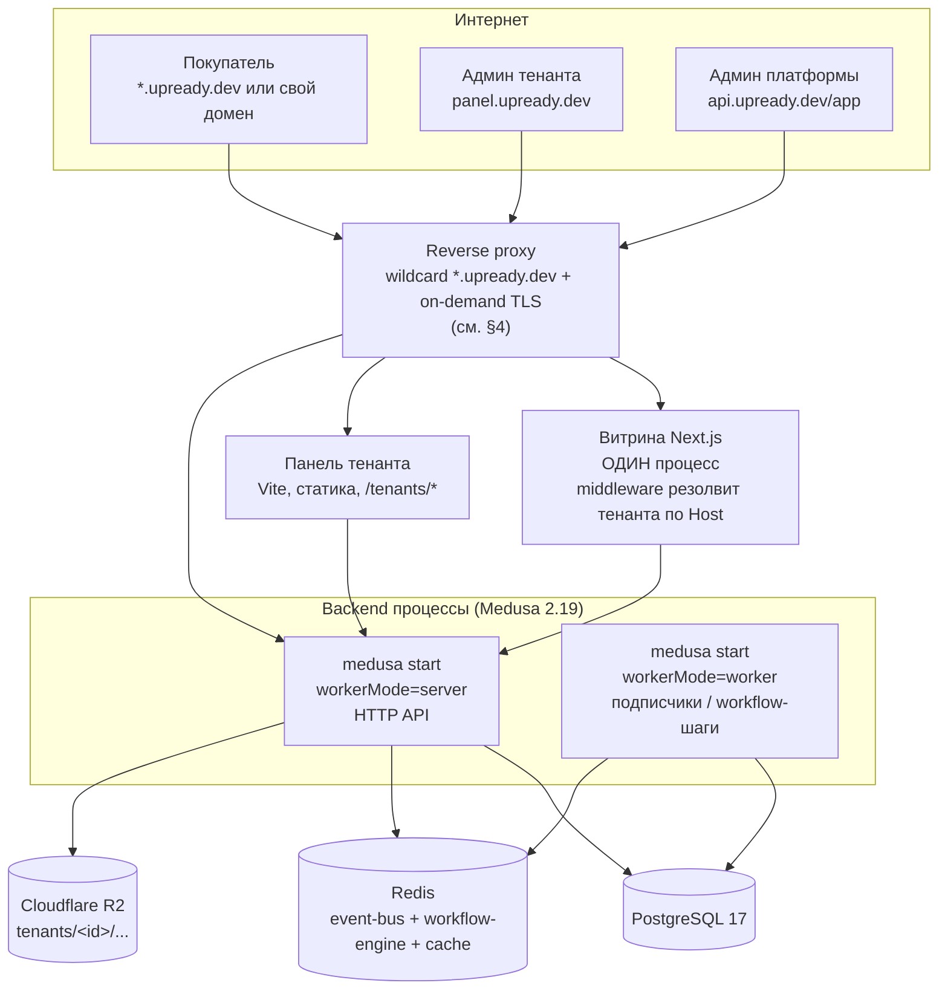

# Сервер и хостинг при росте тенантов (7.4)

Дата: 2026-09-11. Коммит на момент замеров: `816dddc` (ветка `feat/mt-platform`). Автор — воркер
W6 ночной волны платформы (`docs/multitenancy/2026-09-11-night-2-platform-brief.md`, часть B4).

Каждое число ниже — либо замер на локальном стенде (скрипт + сырой вывод рядом,
`artifacts/docs/platform-measurements/`), либо факт со страницы прайсинга/доков провайдера
(`artifacts/research/2026-09-11-hosting/source-*.md`), либо цитата из файла памяти с путём. Где
измерить не удалось — сказано прямо, число не придумано.

## 1. Где сейчас прод

Прод upready-store сегодня — **пять демо-стендов на том же Contabo VPS, где уже стоит
`agent-creatr`** (Иван, чат 2026-09-09 ~22:00 — `~/upready/memory/stands-deploy-decisions-2026-09-09.md`):

- Хост: `root@84.46.251.149` (Contabo), ключ `~/.ssh/id_ed25519_contabo` —
  `~/upready/memory/agent-creatr-prod-deploy-contabo.md`.
- Оркестрация: Coolify на этом хосте, но наши контейнеры **не через UI Coolify** — свой
  `docker compose` в сети `coolify`, traefik-лейблы на уже работающий `coolify-proxy` (entrypoints
  `http`/`https`, резолвер `letsencrypt`, HTTP-01), Cloudflare DNS зоны `upready.dev` с
  `proxied=false` — `~/upready/memory/agent-creatr-prod-deploy-contabo.md`.
- Стенды: `kerbstone|ferrite|scruple|larchant|long-morning.upready.dev` (+ `api-<стенд>.`) —
  `~/upready/memory/stands-deploy-decisions-2026-09-09.md`, раскладка на диске
  `/opt/upready-store/<стенд>` — `deploy/README.md` (этот worktree).
- Замер живого хоста (`deploy/README.md`, «Stand one — measured 2026-09-10»): `free -m` → 11 960 MB
  RAM всего, 7 121 MB available с уже поднятым Kerbstone-триплетом + Coolify + agent-creatr +
  bpj-dev + verdaccio; `df -h /` → 193 GB всего, 107 GB свободно. Число ядер хоста в памяти **не
  найдено** — не выдумываю.
- Реальный footprint ОДНОГО стенда (RSS в состоянии покоя, `docker stats`): backend 331.1 MiB,
  postgres 114 MiB, storefront 98.02 MiB — итого **≈543 MiB на стенд**. Источник — тот же раздел
  `deploy/README.md`.
- Архитектура сегодня — **процесс витрины на тенанта** (каждый стенд = свой `next-server`), что и
  стало поводом для целевой архитектуры ниже: у одного worktree три параллельных `next-server`
  держали до 2,6 GB Turbopack на 16 GB машине —
  `~/upready/memory/decisions/2026-09-10-multitenancy-target-first-config-in-db.md`, последний
  раздел.

Это прод стендов-демо, не прод самой платформы (админки магазинов/онбординга) — той сегодня в
эксплуатации ещё нет, эта спека проектирует именно её хостинг.

## 2. Замеры стенда

Все скрипты — `artifacts/docs/platform-measurements/`, сырой вывод рядом как
`2026-09-11-<what>.txt`. Стенд использовался ОБЩИЙ (та же Postgres на `:5433`, к которой в момент
замеров были параллельно подключены ещё 3-4 бэкенда других ночных сессий — `pg_stat_activity` во
время нагрузочного теста показал 27 открытых соединений) — там, где это меняет интерпретацию
числа, сказано отдельно.

| Метрика | Значение | Единица | Как измерено (скрипт) | Дата |
|---|---|---|---|---|
| RSS `medusa develop` (:9025) | 42 736 | KB (≈41.7 MB) | `ps -o rss -p <pid>`, pid через `lsof -iTCP:9025`; `01-rss-develop.sh` | 2026-09-11 |
| RSS `medusa start`, простой (:9027) | 79 232 | KB (≈77.4 MB) | `ps -o rss -p <pid>` сразу после `Server is ready`; `2026-09-11-rss-start-idle.txt` | 2026-09-11 |
| RSS `medusa start`, после нагрузки (:9027) | 53 776 | KB (≈52.5 MB) | `ps -o rss -p <pid>` сразу после load.mjs; `2026-09-11-rss-start-load.txt` | 2026-09-11 |
| Размер БД `upready_store_mt` | 51 149 847 (49 MB) | bytes | `pg_database_size`; `03-db-size.sh` | 2026-09-11 |
| Крупнейшая таблица — `translation` | 20 922 368 (20 MB) | bytes | `pg_total_relation_size`, топ-10 в файле | 2026-09-11 |
| Строк: `product` / `order` / `tenant` / `sales_channel` | 24 / 6 / 3 / 4 | шт | тот же скрипт | 2026-09-11 |
| p95 `/store/products?limit=12`, develop (:9025), цель 50 rps | 51 786.09 | ms | `load.mjs`, 5s прогрев + 30s; достигнуто 24.1 rps (сервер — узкое место, открытый цикл планирования копит очередь) | 2026-09-11 |
| p95 `/store/products?limit=12`, start (:9027), цель 50 rps | 205 135.35 | ms | тот же `load.mjs`; достигнуто 6.5 rps | 2026-09-11 |
| `apps/backend/static` на этом worktree | не существует (0) | — | `du -sk` → No such file or directory; загрузок local-провайдером здесь не было | 2026-09-11 |
| R2-бакет (`R2_BACKUP_*`) — число объектов/байт | пропущено | — | TLS handshake failure (alert 40) к `<account>.r2.cloudflarestorage.com`, воспроизведено node/curl/openssl; `api.cloudflare.com` и `example.com` с той же машины — нормальный handshake, см. `2026-09-11-r2-bucket.txt` | 2026-09-11 |
| Память машины | 17 179 869 184 (16 GB) | bytes | `sysctl -n hw.memsize` | 2026-09-11 |
| Ядер машины | 10 | шт | `sysctl -n hw.ncpu` | 2026-09-11 |
| macOS | 26.2 | версия | `sw_vers -productVersion` | 2026-09-11 |
| Node | v26.8.1 | версия | `node -v` | 2026-09-11 |
| psql (клиент/сервер) | 17.11 / 16.13 | версия | `psql --version` / `select version()` | 2026-09-11 |

**Честно про p95-строки.** Обе цифры (51.8 с и 205 с при цели 50 rps) — реальный вывод скрипта, но
цикл открытый (`load.mjs` продолжает планировать запросы независимо от того, ответил ли сервер),
и при таком насыщении очередь копится быстро — обе цифры показывают «сервер сильно не успевает за
50 rps», а не «типичная задержка одного запроса». Сравнивать `develop` и `start` между собой этими
числами **нельзя без оговорки**: тест на `:9027` шёл позже теста на `:9025`, и `pg_stat_activity`
в этот момент показал 27 открытых соединений — БД стенда делили минимум 4 параллельных бэкенда
(мой плюс as минимум три других ночных сессии на `:9023`/`:9024`/своём порту). Что число `start`
оказалось хуже `develop` — не диагноз «прод-сборка медленнее», а необъяснённая аномалия при общей
нагрузке на общую БД; чистый (изолированный) повтор — открытый пункт (см. `OPEN` в возврате
сессии). Качественный вывод, который эти цифры всё же подтверждают надёжно: **51 rps каталожных
запросов — уже перегрузка для одного бэкенд-процесса на этой машине**, независимо от режима; малое
число тенантов (10-50) с типичной посещаемостью не подойдёт к этому порогу, но его стоит держать в
уме при планировании второго инстанса витрины/бэкенда (§6).

Для реалистичного «сколько ест бэкенд/витрина в проде» ниже (§5) используется в первую очередь
**число из живого Contabo-стенда** (331 / 98 / 114 MiB, §1) — оно снято под настоящим
Docker-лимитом и настоящим трафиком верификации, а не под пустым локальным процессом с 3
тенантами; локальные RSS-цифры выше — нижняя граница (idle, без реального трафика, без S3/тем).

## 3. Целевая топология

Один backend-процесс Medusa в режиме `workerMode` (опция `projectConfig.workerMode`,
`node_modules/@medusajs/framework/dist/config/config.js:109-124`, допустимые значения
`"shared" | "worker" | "server"`, по умолчанию `"shared"` — один процесс делает всё; для реального
разделения сервер/воркер поднимаются ДВА процесса с `workerMode: "server"` и `workerMode:
"worker"` соответственно) — PostgreSQL 17 — Redis — один мультитенантный процесс витрины (тенант
резолвится по `Host`, решение и задача `t-2026-09-12-mt-storefront-by-host`,
`~/upready/memory/decisions/2026-09-10-multitenancy-target-first-config-in-db.md`) — статичная
панель тенанта — reverse proxy — R2.

**Redis — не опционально для этой топологии.** Тот же `config.js` (строка ~103) логирует «redisUrl
not found. A fake redis instance will be used» и подставляет ин-процессный фейковый Redis, когда
`redisUrl` не задан — а два ОТДЕЛЬНЫХ процесса (`server` и `worker`) физически не могут делить
ин-процессную подделку между собой: без настоящего Redis `workerMode` со split server/worker не
имеет смысла (см. §6).



## 4. Прокси для доменов тенантов

### Wildcard `*.upready.dev`

Каждый тенант получает `<handle>.upready.dev` с момента создания. DNS: **одна** wildcard-запись
`A`/`AAAA` на IP прокси (`*.upready.dev → <ip proxy>`), сертификат — **один статический
wildcard-сертификат** через DNS-01 (Cloudflare DNS-плагин), выпущенный заранее и продлеваемый по
своему расписанию — НЕ через on-demand TLS: обе изученные системы (источники 5 и 6) требуют
DNS-01 именно для wildcard и именно НЕ в связке с on-demand-выдачей (on-demand работает через
HTTP-01/TLS-ALPN-01, DNS-01 просит знать домен заранее — несовместимо с «домен появился прямо
сейчас, реши на лету»).

### Кастомные домены (`vasya.com`, `petya.ru`)

**Caddy** с On-Demand TLS: `on_demand_tls.ask` — эндпоинт бэкенда, который Caddy опрашивает перед
выпуском сертификата для незнакомого домена (источник 5). Предлагаемый (НЕ построенный) эндпоинт:
`GET /store/tenant-domains/check?domain=` → 200 только если домен сохранён за каким-то тенантом,
иначе 4xx — Caddy отказывает в выпуске. Рейт-лимит — общий ACME-лимит аккаунта (источник 5 даёт
только общую цифру «10 попыток ACME на аккаунт за 10 секунд», специфического on-demand-лимита
страница не раскрыла — конкретное значение `interval`/`burst` для `on_demand_tls` не зафиксировано
живьём, читать в доке `on_demand_tls` перед конфигурацией). Домен без записи в БД (Host, которого
прокси не знает) — **404/редирект на upready.dev, сертификат никогда не запрашивается** (`ask`
отвечает отказом раньше, чем Caddy тронет ACME).

Кастомные домены проверяются **HTTP-01** (не DNS-01 — мы не владеем чужой зоной DNS; HTTP-01
работает, потому что A-запись домена уже указывает на наш прокси — это ровно то, что тенант
настраивает по инструкции ниже).

### DNS-инструкция для тенанта (как в панели, дословно)

```
Чтобы подключить свой домен к магазину:

1. Зайдите в панель управления вашего регистратора домена (там, где вы его купили).
2. Добавьте A-запись:
   Тип:   A
   Имя:   @  (или пусто — означает "весь домен")
   Значение: <IP прокси>
   TTL:   3600 (или "Auto")

   Если ваш регистратор поддерживает ALIAS/ANAME для корневого домена — можно использовать её
   вместо A-записи, значение то же.

3. (Рекомендуется) Добавьте CNAME для www:
   Тип:   CNAME
   Имя:   www
   Значение: <handle>.upready.dev
   TTL:   3600

4. Нажмите "Проверить домен" в этой панели.

Что происходит дальше: мы каждые несколько минут проверяем, куда указывает ваш домен (DNS-lookup).
Как только он начнёт указывать на наш сервер, домен активируется автоматически и получит
собственный сертификат безопасности (HTTPS) — обычно это занимает от 5 минут до нескольких часов,
это время нужно вашему регистратору, чтобы разослать запись по всему интернету (DNS-пропагация,
от нас не зависит).

Пока домен не активирован: ваш магазин продолжает работать по адресу <handle>.upready.dev — ничего
не сломается. Статус в этой панели будет показывать "Проверяем DNS...", а после активации сменится
на "Домен подключён".
```

Технический субдомен `<handle>.upready.dev` **продолжает работать всегда**, даже после подключения
кастомного домена — это одна и та же запись `domains` на одного тенанта, прокси просто отвечает на
оба `Host`.

### Как один `Host` превращается в конкретную витрину

`reverse_proxy` прокси сохраняет заголовок `Host` без изменений (это поведение по умолчанию и у
Caddy, и у Traefik) → единственный процесс витрины получает исходный `Host` → middleware витрины
резолвит тенанта по нему из БД (таблица доменов, задача `t-2026-09-12-mt-storefront-by-host`) →
достаёт publishable key и пресет темы тенанта → рендерит его магазин. Нормализация: `www.<домен>` и
голый `<домен>` резолвятся в одного тенанта (по значению без `www.` в таблице доменов); домен,
для которого нет записи (например, отвязанный) — 404 на уровне витрины, отдельно от 404 на уровне
прокси для неизвестного `Host` вообще.

### Caddyfile-набросок (≤40 строк)

```caddyfile
{
	on_demand_tls {
		ask https://api.upready.dev/store/tenant-domains/check
	}
}

# Wildcard-поддомены платформы — один статический сертификат, DNS-01.
*.upready.dev {
	tls {
		dns cloudflare {env.CLOUDFLARE_API_TOKEN}
	}
	reverse_proxy storefront:3000
}

api.upready.dev {
	tls {
		dns cloudflare {env.CLOUDFLARE_API_TOKEN}
	}
	reverse_proxy backend:9000
}

panel.upready.dev {
	tls {
		dns cloudflare {env.CLOUDFLARE_API_TOKEN}
	}
	reverse_proxy panel:80
}

# Кастомные домены тенантов — любой Host, не покрытый блоками выше,
# приходит сюда; on_demand_tls решает через ask, стоит ли выпускать сертификат.
:443 {
	tls {
		on_demand
	}
	reverse_proxy storefront:3000
}
```

## 5. Таблица роста

Допущения (формулы, не цифры с потолка):

- **DB(N) ≈ 20 MB (фикс: справочники/`translation`) + N × 10 MB.** Источник коэффициента: на
  стенде 3 тенанта дают 49 MB суммарно, из них 20 MB — таблица `translation` (справочная, не
  растёт с числом тенантов), остаток ≈29 MB / 3 ≈ 9.7 MB на тенанта, округлено до 10 MB (§2).
  Экстраполяция за пределы измеренного диапазона (3 тенанта) — грубая, помечена курсивом в
  таблице.
- **Backend RSS на процесс ≈ 331 MiB** (реальный Docker-замер одного прод-бэкенда, §1) —
  топология §3 держит backend ОДНИМ процессом (server) + вторым (worker) на всех тенантов сразу,
  не по процессу на тенанта, так что это число почти не растёт с N до тех пор, пока хватает
  connection pool к Postgres; после порога — второй `server`-инстанс за балансировщиком.
- **Storefront RSS на процесс ≈ 98 MiB** (тот же прод-замер) — один процесс на ВСЮ платформу
  (§3), растёт не с числом тенантов, а с одновременной посещаемостью; второй инстанс — по CPU/p95,
  не по N (см. §6, CPU хоста в проде не измерено — открытый пункт).
- **Файлы: $0.015/GB-month** (R2 Standard storage, источник 4) — без замера текущего объёма
  бакета (TLS-фейл, §2), берём на объект дела по прайсу, не по факту.
- **p95 headroom**: локальный замер (§2) показал насыщение уже на цели 50 rps каталожных
  запросов ОДНИМ процессом при общей нагрузке на стенд — используется как качественный, не
  количественный порог (число подтверждено, но замер делил БД с чужими сессиями).

| Тенантов | Backend | Storefront | PG | Прокси | Цена/мес (провайдер, план) | Обоснование |
|---|---|---|---|---|---|---|
| 10 | 1× server (+1× worker опц.) | 1 инстанс | на том же VPS | 1 инстанс, статич. wildcard | Contabo Cloud VPS 4 (4 vCPU/8 GB) — **€5.50** (источник 2) | DB(10)≈120 MB, backend 331 MiB + storefront 98 MiB + PG 114 MiB ≈ 543 MiB — укладывается в 8 GB с большим запасом (тот же footprint, что уже держит один прод-стенд, §1) |
| 50 | 1× server + 1× worker (Redis обязателен) | 1-2 инстанса | тот же VPS или managed | 1 инстанс | Contabo Cloud VPS 8 (8 vCPU/24 GB) — **€14.00** (источник 2) | DB(50)≈520 MB; split server/worker требует настоящего Redis (config.js, §3) — Redis-контейнер добавляет заметный, но не измеренный этой ночью footprint (открытый пункт) |
| 200 | 2× server за балансировщиком + 2× worker | 2 инстанса за балансировщиком | managed PG | 1-2 инстанса прокси | Contabo Cloud VPS 16 (16 vCPU/64 GB) — **€37.00** + Neon Launch, метрика (источник 2, 3) | DB(200)≈2 GB — всё ещё в пределах self-host, но приближается к порогу §6; второй backend-инстанс — по насыщению 50 rps/процесс, замеренному в §2 |
| 1000 | N× server за балансировщиком + N× worker | 3+ инстанса, CDN перед статикой | managed PG обязателен | балансировщик + wildcard/on-demand на отдельном узле | Contabo Cloud VPS 16 ×2-3 узла + Neon Scale, метрика (источник 2, 3) — точная сумма зависит от реального QPS/тенанта, не измеренного | DB(1000)≈10 GB — за порогом self-host (§6); при 543 MiB/стенд-эквивалент старой архитектуры 1000 отдельных витрин физически не влезли бы никуда — это ровно причина решения «одна витрина по Host» (§1) |

Hetzner в этой таблице не участвует ценой (§8, `source-1`: живые EUR-цифры не получены,
JS-рендеринг), но его CX/CAX линейка (2 vCPU/4 GB … 16 vCPU/32 GB, NVMe) — прямая замена
Contabo-плана в каждой строке при том же порядке величин; см. §7.

## 6. Пороги

- **Managed PG вместо self-host: ориентировочно при DB(N) > 5-10 GB или N > 150-200 тенантов**
  (экстраполяция формулы DB(N) из §5; при DB≈10 GB self-host на VPS уже конкурирует с диском и
  бэкапами, а Neon Launch/Scale в этом диапазоне метрируется предсказуемо, источник 3).
- **Второй инстанс витрины: когда p95 каталожных запросов на ОДИН процесс подходит к насыщению,
  измеренному в §2 (около 50 rps на процесс на текущем железе стенда)** — это качественный
  порог, не точная цифра для прод-железа (замер шёл на общей БД с чужой нагрузкой, §2); перед тем
  как принимать решение о масштабировании в проде — переизмерить изолированно.
- **Redis становится обязательным, как только `workerMode` разносится на `server` + `worker` в
  разные процессы** — без настоящего `redisUrl` framework подставляет ин-процессную подделку
  (`config.js` строка ~103), которую два процесса делить не могут; до этого момента (режим
  `shared`, один процесс) Redis нужен только для персистентности между рестартами кэша/очереди
  событий, не для корректности.

## 7. Развилка провайдера

1. **Contabo** (рекомендация по умолчанию — уже проверенный хост). Причина: тот же провайдер уже
   держит пять демо-стендов и `agent-creatr` живьём (§1) — нулевой риск незнакомой платформы,
   реальные VPS-планы с ценами подтверждены (источник 2), traefik/Coolify-обвязка уже отлажена
   (грабли с алиасами сетевых имён, entrypoint-именами — все найдены и закрыты на этом же хосте,
   `~/upready/memory/agent-creatr-prod-deploy-contabo.md`).
2. **Hetzner.** Причина рассмотреть: заметно более низкая цена за то же железо у конкурентов при
   сопоставимых CX/CAX-планах (по неподтверждённым сегодня, но публично известным EUR-цифрам —
   перепроверить калькулятором перед решением, §8/OPEN) и заявленный лучший сетевой перформанс в
   EU; цена сегодня НЕ подтверждена живым фетчем (источник 1) — решение откладывается до момента,
   когда кто-то откроет калькулятор руками.
3. **Managed-платформа (Render/Railway/Fly.io — не проверялись этой ночью).** Причина
   рассмотреть: ноль DevOps-работы на масштабирование и TLS (то, что здесь спроектировано в §3-4
   руками), но заметно выше цена за единицу RAM/CPU и меньше контроля над on-demand TLS
   custom-доменов (эта механика — ключевая часть продукта, §4) — обычно не первоклассная фича на
   managed-PaaS, требует проверки конкретной платформы, не входила в объём этой ночи.

**Что решает Иван:** зафиксировать Contabo (продолжение текущего хоста) или выделить время на
подтверждение цен Hetzner живым калькулятором перед сравнением; managed-платформа — только если
готовность отказаться от on-demand TLS кастомных доменов как first-class фичи приемлема.

## 8. Источники

Замеры (все в `artifacts/docs/platform-measurements/`, эта ветка):
- `01-rss-develop.sh` → `2026-09-11-rss-develop.txt`
- `2026-09-11-rss-start-idle.txt`, `2026-09-11-rss-start-load.txt`
- `03-db-size.sh` → `2026-09-11-db-size.txt`
- `load.mjs` → `2026-09-11-load-develop-9025.txt`, `2026-09-11-load-start-9027.txt`
- `2026-09-11-static-size.txt`
- `05-r2-bucket.mjs` → `2026-09-11-r2-bucket.txt` (пропущено, диагностика внутри)
- `06-machine.sh` → `2026-09-11-machine.txt`

Прайсинг и документация (все в `artifacts/research/2026-09-11-hosting/`, дата фетча 2026-09-11):
- `source-1-hetzner-cloud.md` — характеристики CX/CAX/CPX получены, живые цены EUR — нет (JS-рендер)
- `source-2-contabo-vps.md` — Cloud VPS 4/6/8/12/16/18, цены получены
- `source-3-neon-managed-postgres.md` — Free/Launch/Scale, цены получены
- `source-4-cloudflare-r2-pricing.md` — Standard/Infrequent Access, цены получены
- `source-5-caddy-on-demand-tls.md` — ask-эндпоинт, ограничения DNS-01/wildcard
- `source-6-traefik-acme-reference.md` — `ref-acme.yaml` из `traefik/traefik@master`, нет ask-аналога

Память (упомянуты выше с путями): `agent-creatr-prod-deploy-contabo.md`,
`stands-deploy-decisions-2026-09-09.md`,
`decisions/2026-09-10-multitenancy-target-first-config-in-db.md`.

Код: `apps/backend/medusa-config.ts`, `apps/backend/.env`, `deploy/compose.stand.yml`,
`deploy/README.md`, `node_modules/@medusajs/framework/dist/config/config.js` (workerMode,
redis-фейк).
