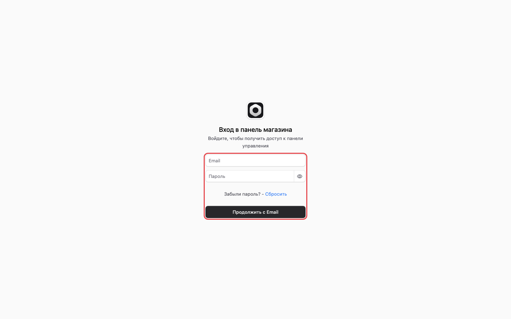
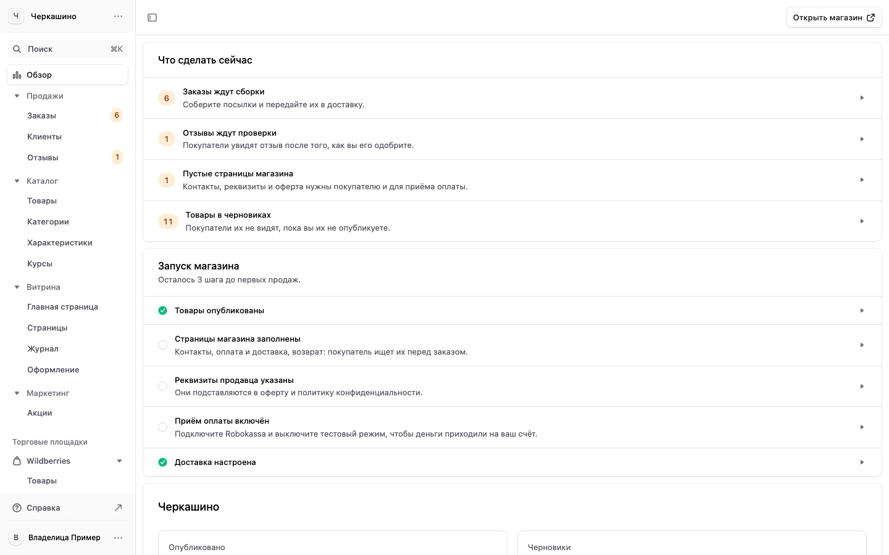
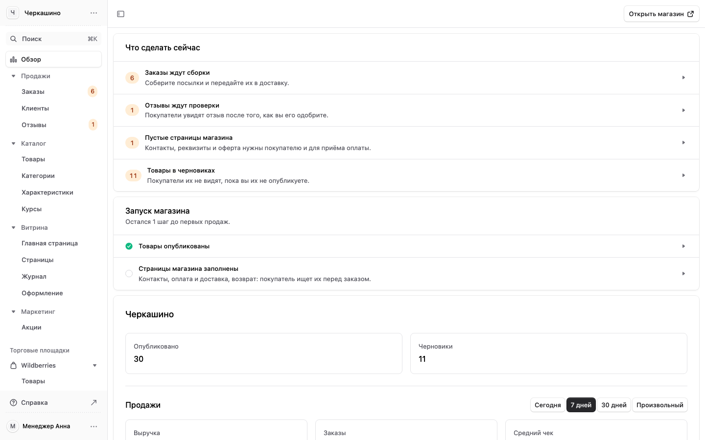
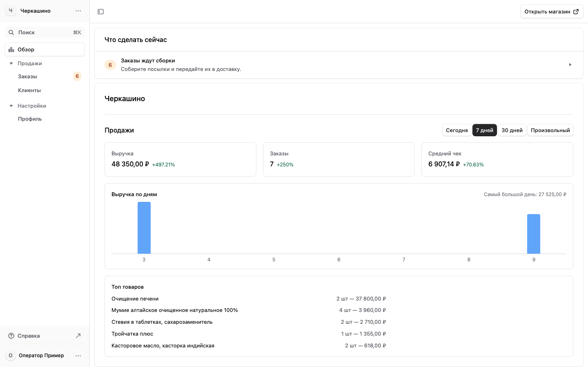
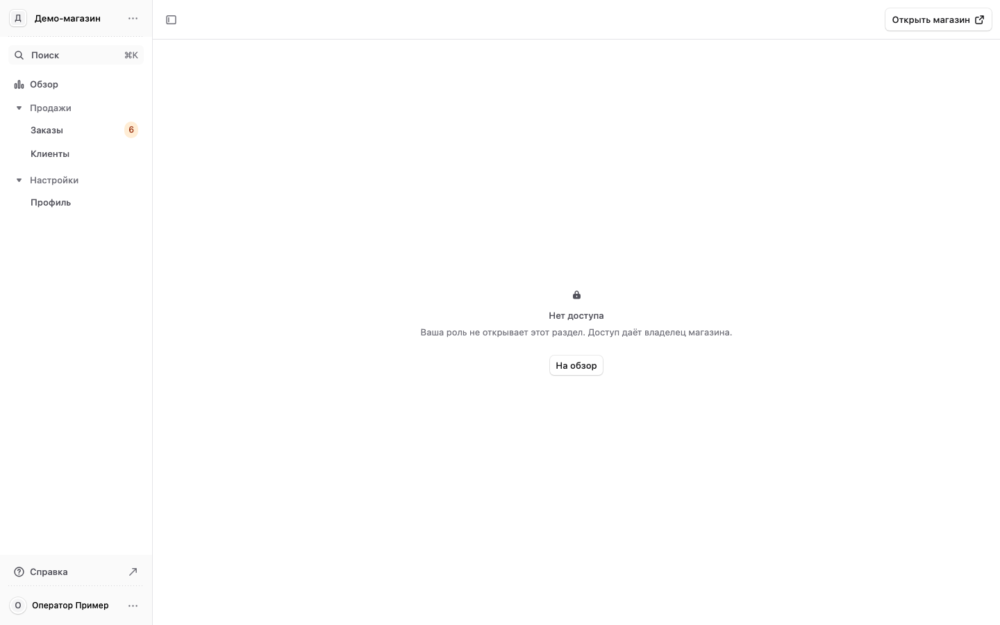
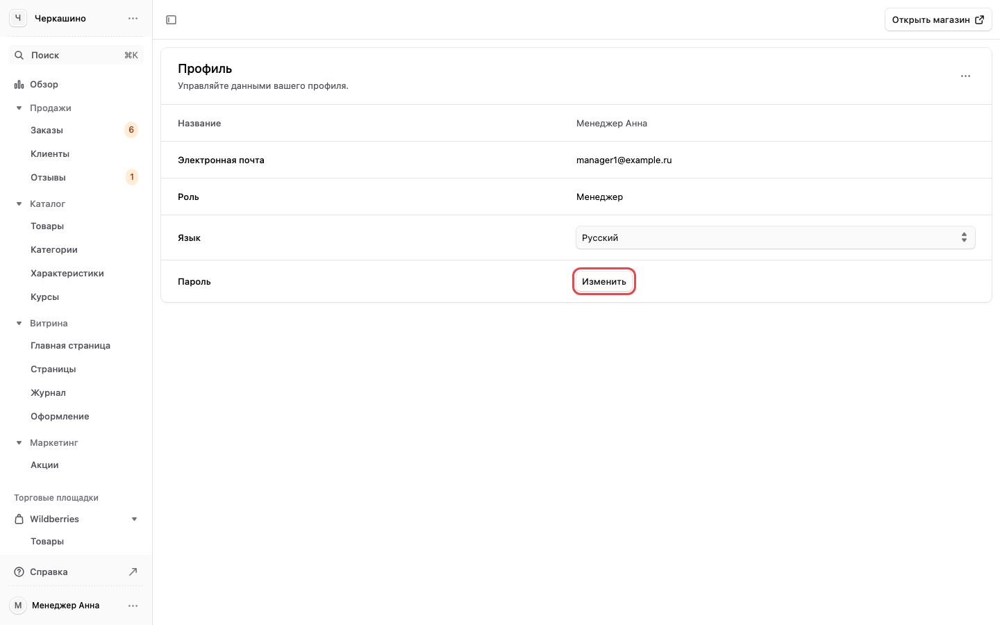

# 1. Вход, меню и роли

[← Оглавление](00-oglavlenie.md)

## Войти в панель

1. Откройте [panel.cherkashino.ru](https://panel.cherkashino.ru/login).
2. Впишите почту и пароль, которые выдала владелица, и нажмите «Продолжить с Email».
3. Пароль забыли — нажмите «Сбросить» под формой. Если письмо не пришло, попросите владелицу задать
   новый пароль в разделе «Сотрудники» ([раздел 7](07-nastrojki.md#сотрудники-и-роли)).

## Что видно после входа

Первым открывается «Обзор». Вверху блок «Что сделать сейчас»: заказы, которые ждут сборки, отзывы,
которые ждут проверки, незаполненные страницы магазина. Нажмите строку, и откроется нужный список.
Ниже — сколько товаров опубликовано, продажи за выбранный срок.

Слева меню. Разделы сгруппированы по делам: «Продажи», «Каталог», «Витрина», «Маркетинг»,
«Торговые площадки», «Настройки». Цифра рядом с пунктом — сколько там ждёт вас: заказы к сборке,
отзывы к проверке. Внизу меню ваше имя. Через «…» рядом с ним можно выйти.

Над именем пункт «Справка»: эта инструкция. Она открывается в новой вкладке, и экран панели
остаётся на месте.

Кнопка «Открыть магазин» вверху справа открывает сайт магазина в новой вкладке.

Поиск: нажмите «Поиск» вверху меню или ⌘K (на Windows Ctrl+K), начните вводить название раздела,
товара или номер заказа.

## Роли: кто что видит

У каждого логина своя роль. Роль выбирает владелица, когда заводит сотрудницу.

| Раздел меню | Владелец | Менеджер | Оператор |
|---|---|---|---|
| Обзор | да | да | да |
| Продажи: Заказы, Клиенты | да | да | да |
| Продажи: Отзывы | да | да | нет |
| Каталог: Товары, Категории, Характеристики, Курсы | да | да | нет |
| Витрина: Главная страница, Страницы, Журнал, Оформление | да | да | нет |
| Маркетинг: Акции | да | да | нет |
| Торговые площадки: Wildberries, Ozon | да | да | нет |
| Настройки: Доставка, Оплата, Реквизиты, Адрес магазина, Сайты, Язык и валюта, Уведомления, Вход покупателей, Поиск и счётчики | да | нет | нет |
| Настройки: Сотрудники | да | нет | нет |
| Свой профиль: имя и пароль | да | да | да |

- **Владелец** видит всё. Только он настраивает оплату, доставку, реквизиты и заводит сотрудников.
- **Менеджер** ведёт магазин: заказы, покупателей, отзывы, товары, курсы, витрину, акции и
  маркетплейсы. Настроек магазина у него нет.
- **Оператор** только принимает и отправляет заказы и смотрит покупателей.

Так выглядит меню менеджера: группы «Настройки» нет.

Так выглядит меню оператора: обзор, заказы, клиенты и профиль.

Если открыть раздел, которого нет в вашей роли (например, по ссылке из письма), панель покажет экран
«Нет доступа». Это не ошибка: попросите владелицу, если раздел нужен для работы.

## Сменить свой пароль и имя

1. Внизу меню нажмите «…» рядом со своим именем и выберите «Настройки профиля». У владелицы
   «Профиль» есть ещё и в группе «Настройки».
2. Пароль: нажмите «Изменить» в строке «Пароль». Впишите текущий пароль, новый (не короче
   12 символов) и новый ещё раз, сохраните.
3. Имя и язык панели: «…» в правом верхнем углу блока «Профиль».

В профиле видна и ваша роль. Там же, в «…» у имени внизу меню, можно выбрать тёмную тему и выйти.

