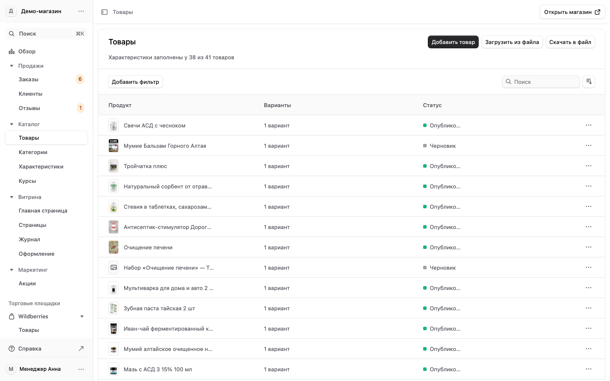
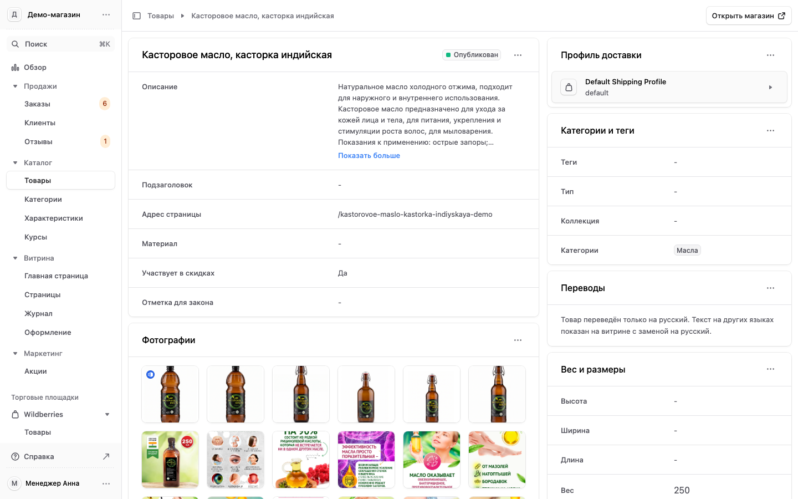
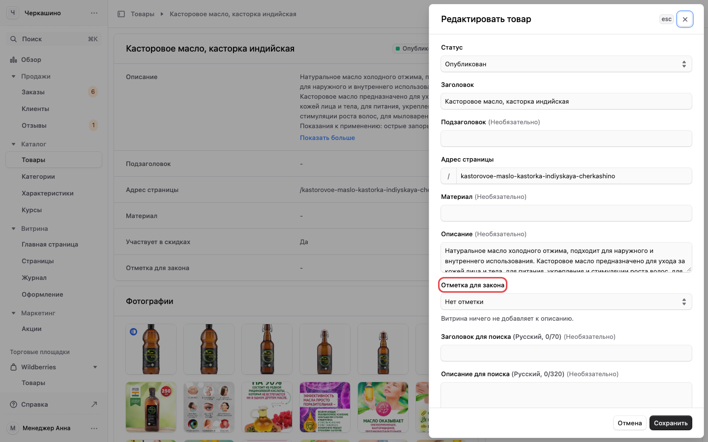
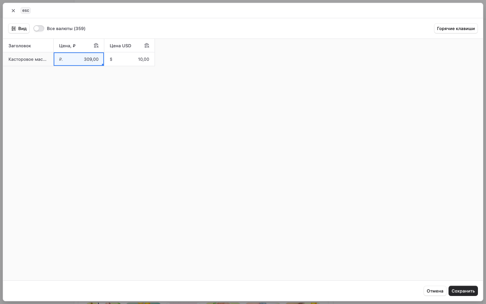
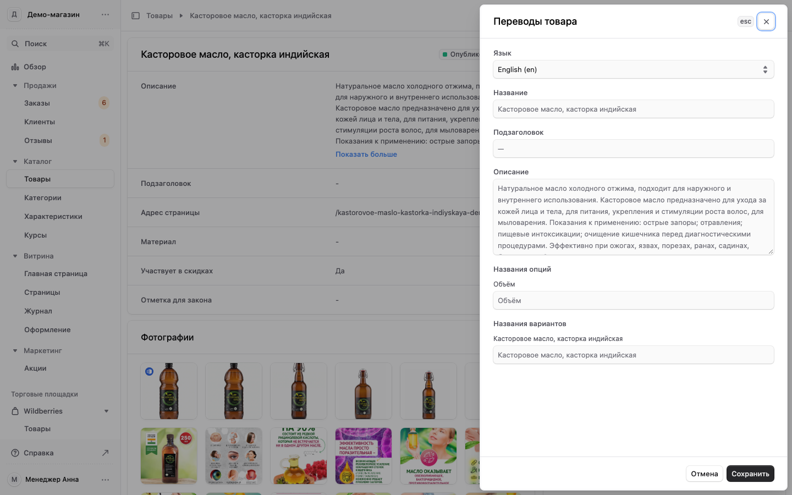
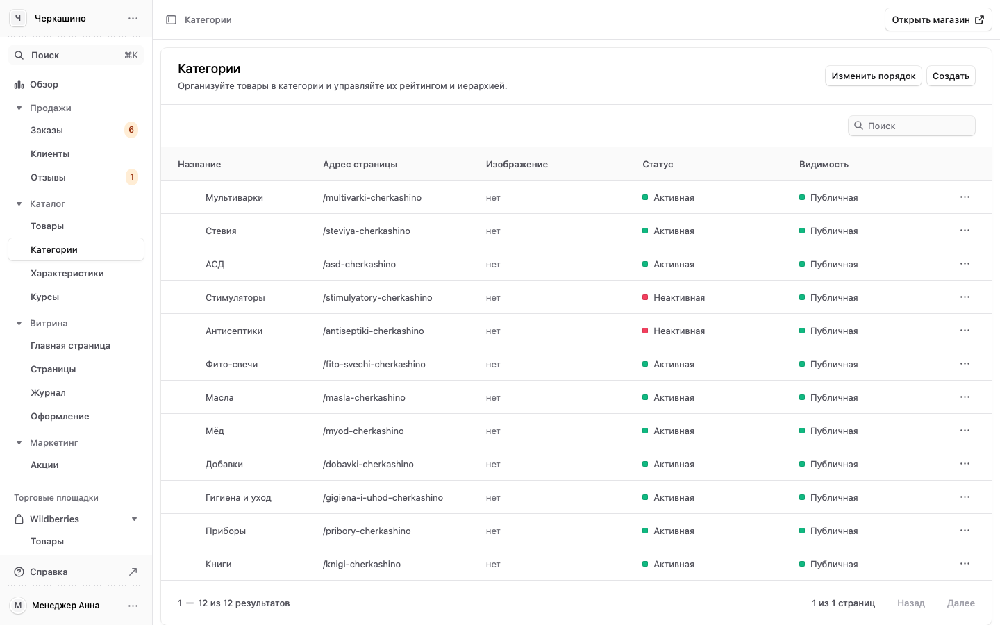

# 4. Товары: тексты, цены, фото, отметка БАД, переводы

[← Оглавление](00-oglavlenie.md)

Раздел «Каталог». Он есть у менеджера и владельца.

## Список товаров

«Каталог» → «Товары». В списке опубликованные товары и черновики. Черновик покупатели не видят.
«Добавить фильтр» оставляет, например, только черновики. Нажмите строку, чтобы открыть товар.

## Карточка товара

Слева описание и поля товара, ниже «Фотографии», «Варианты» (объём, вес, цена каждого варианта),
«Характеристики». Справа «Категории и теги», «Переводы», «Вес и размеры». У каждого блока в правом
верхнем углу «…»: там действия этого блока.

## Поправить название, описание, статус

1. В карточке товара нажмите «…» в верхнем блоке → «Редактировать».
2. Справа откроется форма: «Статус» (опубликован или черновик), «Заголовок», «Подзаголовок»,
   «Адрес страницы», «Описание», «Отметка для закона», поля для поиска.
3. Поправьте и нажмите «Сохранить».

Описание товара не должно обещать лечения: так требуют закон и правила Robokassa. Пишите о составе и
способе применения.

## Отметить товар как БАД или лекарство

В той же форме «Редактировать товар» поле «Отметка для закона»:

| Что выбрать | Что будет на сайте |
|---|---|
| Нет отметки | витрина ничего не добавляет к описанию |
| БАД (биологически активная добавка) | под описанием появится надпись «Не является лекарственным средством»: закон «О рекламе» требует это предупреждение в рекламе БАД |
| Лекарственное средство | надпись не добавляется. Через интернет лекарства продаёт только аптека с лицензией |

Если магазин продаёт добавки, отметьте каждую. Выберите вариант и нажмите «Сохранить».

## Фотографии

Блок «Фотографии» в карточке → «…» → «Изменить фотографии». Там добавляют новые фотографии, удаляют
старые и меняют порядок.

## Цены

Блок «Варианты» → «…» → «Редактировать цены». Откроется таблица: строка — вариант товара, колонка —
цена в рублях. Впишите новую цену и нажмите «Сохранить».

## Перевод товара на другой язык

Перевод нужен, если у сайта магазина есть версия на другом языке, например на английском. Какие
языки есть на сайте, задаёт владелец: «Настройки» → «Язык и валюта».

1. Блок «Переводы» справа → «…» → «Перевести».
2. Выберите язык, например English (en).
3. Впишите название и описание на этом языке, нажмите «Сохранить».

Пока перевода нет, сайт на другом языке показывает русский текст.

## Категории

«Каталог» → «Категории». Здесь дерево категорий каталога. В категорию товар добавляют в его карточке:
блок «Категории и теги» → «…». В «Характеристиках» хранятся общие свойства товаров, например объём
или состав: покупатель видит их на странице товара.

