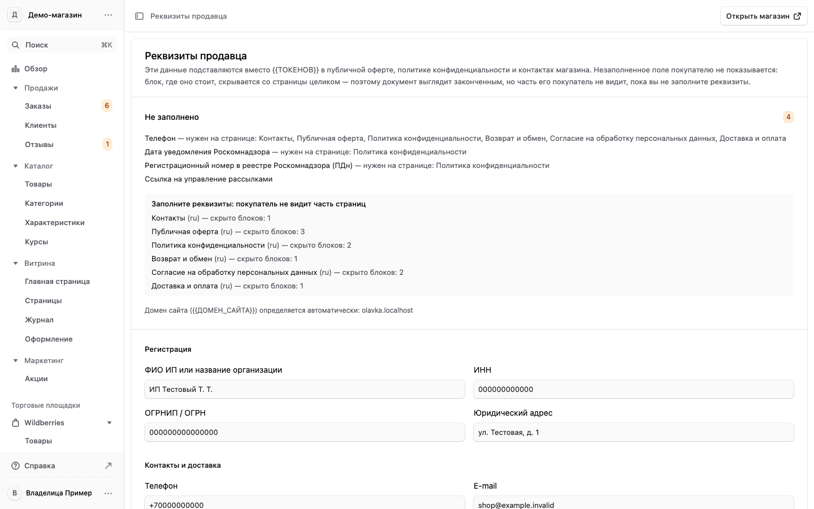
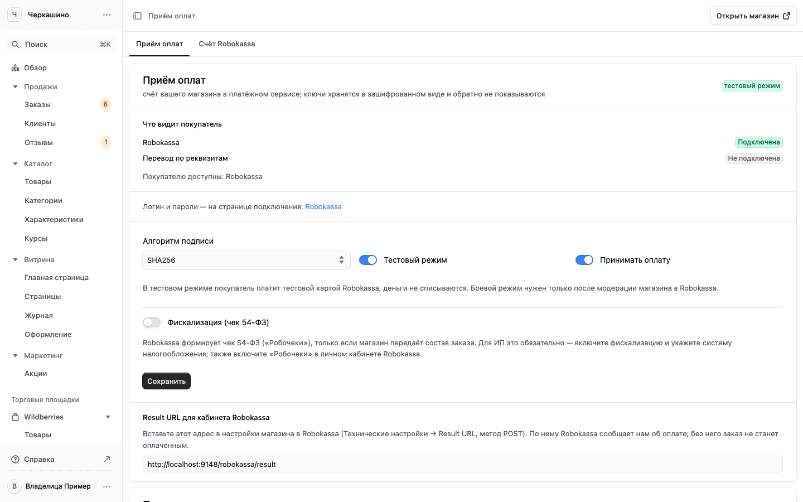

# 8. Как отправить магазин на модерацию в Robokassa

[← Оглавление](00-oglavlenie.md)

Пока Robokassa не проверила магазин, оплата на сайте тестовая: покупатель платит тестовой картой,
деньги не списываются. После одобрения магазин переключается на настоящие платежи.

Подаёт магазин на проверку тот, у кого личный кабинет Robokassa. Данные для сайта вписывает
владелица в панели. Порядок такой: сначала сайт, потом кабинет, потом подача.

Список собран по проверкам сайта 08.10.2026 и чек-листу передачи 09.10.2026. Если какой-то шаг с тех
пор сделан, просто отметьте его.

## Что на сайте уже готово

Проверено 08.10.2026 гостем и браузером на живом сайте.

- Сайт открывается, все 49 страниц из карты сайта отвечают.
- В подвале каждой страницы реквизиты продавца и знак Robokassa.
- Есть оферта, политика конфиденциальности, «Доставка и оплата», «Возврат и обмен», контакты.
- Цены только в рублях. Карта сайта — только русские адреса.

## Шаг 1. Реквизиты в панели (владелица)

«Настройки» → «Реквизиты» ([раздел 7](07-nastrojki.md#реквизиты-продавца)). После сохранения данные
сами появятся в оферте, политике, контактах, возврате и на странице доставки.

| Что вписать | Почему |
|---|---|
| **E-mail магазина** | Без почты модерацию не пройти. Требование Robokassa: «Электронная почта и телефон для связи есть на сайте, не скрыты и доступны» |
| **Телефон** — и нажать «подтвердить» рядом | Без подтверждения номер не выходит в оферту и контакты |
| **Юридический адрес** — хотя бы город | Robokassa: «Для ИП и для самозанятых достаточно указать город» |
| **Адрес возврата** с получателем | Сейчас на странице возврата адрес без слова «улица» и без получателя |

Ещё две вещи на сайте, которые решает владелица:

- **Сроки и стоимость доставки числами** на странице «Доставка и оплата»: хотя бы «от … дней» и «от …
  рублей». Сейчас там «рассчитывается при оформлении».
- **Доставка в страны СНГ.** Оферта и страница доставки её обещают, а оформить заказ можно только по
  России. Если доставки в СНГ нет, эти слова нужно убрать.

## Шаг 2. Товары без обещаний лечения

Это главный риск отказа. В перечне запрещённого у Robokassa есть «Лекарства без лицензии»,
«Биологически активные добавки с недоказанным эффектом», «Псевдонаучные товары и услуги». Проверка
сайта нашла обещания лечения тяжёлых болезней в шести карточках: пять товаров с АСД и курс «Очищение
печени».

Нужно решить с владелицей одно из двух:

1. переписать эти карточки без слов о лечении и без схем приёма (готовый набор правок текстов есть
   у разработчика), или
2. снять эти товары с витрины на время проверки: перевести в черновик
   ([раздел 4](04-tovary.md#поправить-название-описание-статус)).

Заодно отметьте добавки как БАД ([раздел 4](04-tovary.md#отметить-товар-как-бад-или-лекарство)):
тогда под описанием появится обязательная надпись «Не является лекарственным средством».

## Шаг 3. Документы на товары (владелица)

Подготовьте свидетельства о регистрации на добавки, декларации на косметику, регистрационное
удостоверение на ингалятор (это медицинское изделие). В перечне Robokassa есть «Товары без
сертификатов соответствия», и модератор вправе их спросить. Оферта тоже обещает их покупателю по
запросу.

## Шаг 4. Личный кабинет Robokassa

1. **Анкета.** ФИО, ИНН, ОГРНИП, телефон и почта — те же, что на сайте. ИНН сверьте с выпиской из
   реестра ИП.
2. **Адрес сайта:** [https://cherkashino.ru/ru](https://cherkashino.ru/ru) — с окончанием `/ru`. Адрес
   без него отвечает переадресацией, а Robokassa требует «прямую ссылку на ваш сайт без переадресации».
3. **Описание деятельности:** всё, что продаёт сайт. Если онлайн-курсы остаются на сайте — «товары и
   онлайн-курсы», иначе сайт разойдётся с анкетой.
4. **Документы:** ИНН, ОГРНИП, паспорт, расчётный счёт, система налогообложения. Точный список
   менеджер Robokassa называет после предварительной проверки.
5. **Чеки.** Сайт обещает покупателю кассовый чек. Включите «Робочеки» в кабинете и «Фискализация
   (чек 54-ФЗ)» в панели: «Настройки» → «Оплата» ([раздел 7](07-nastrojki.md#оплата)).
6. **Технические настройки.** Адрес уведомления об оплате (Result URL):
   [https://api.cherkashino.ru/robokassa/result](https://api.cherkashino.ru/robokassa/result), метод POST,
   для боевого и для тестового режима. Этот же адрес показан в панели внизу «Настройки» → «Оплата».
   Адреса, куда покупатель возвращается после оплаты, сайт передаёт сам в каждом платеже.
7. **Тестовая оплата.** Войдите на сайт через Яндекс, оформите заказ и оплатите тестовой картой.
   После «Успешно» должна открыться страница заказа, а не «Оплата подтверждается». Если остаётся
   «Оплата подтверждается», Result URL в кабинете не задан или задан неверно.
8. **Отправьте магазин на проверку.**

## После подачи

- Следите за личным кабинетом. Robokassa: «Если потребуются доработки — сообщим в личном кабинете».
- Не меняйте адрес сайта и не отключайте сайт, не предупредив Robokassa: «обязательно уведомите нас
  перед отключением сайта или сменой URL».
- После одобрения впишите в панели боевые пароли из кабинета («Настройки» → «Оплата», вкладка
  «Счёт Robokassa») и выключите «Тестовый режим».

## Короткий список перед подачей

| № | Что | Кто | Где |
|---|---|---|---|
| 1 | Почта, подтверждённый телефон, город, адрес возврата | владелица | панель → «Реквизиты» |
| 2 | Сроки и цены доставки числами, решение про СНГ | владелица | ответ разработчику |
| 3 | Карточки с обещаниями лечения переписаны или скрыты | владелица и разработчик | панель → «Товары» |
| 4 | Добавки отмечены как БАД | менеджер | панель → «Товары» |
| 5 | Документы на товары собраны | владелица | — |
| 6 | Анкета, адрес сайта с `/ru`, описание деятельности | владелец кабинета | кабинет Robokassa |
| 7 | Робочеки и фискализация | владелец кабинета и владелица | кабинет и панель → «Оплата» |
| 8 | Result URL, тестовая оплата прошла до страницы заказа | владелец кабинета | кабинет, сайт |
| 9 | Подача на проверку | владелец кабинета | кабинет Robokassa |
