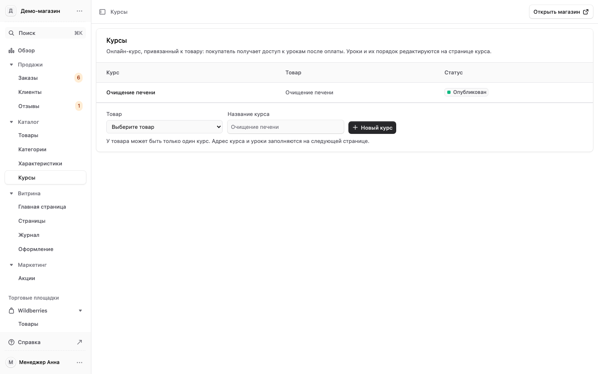
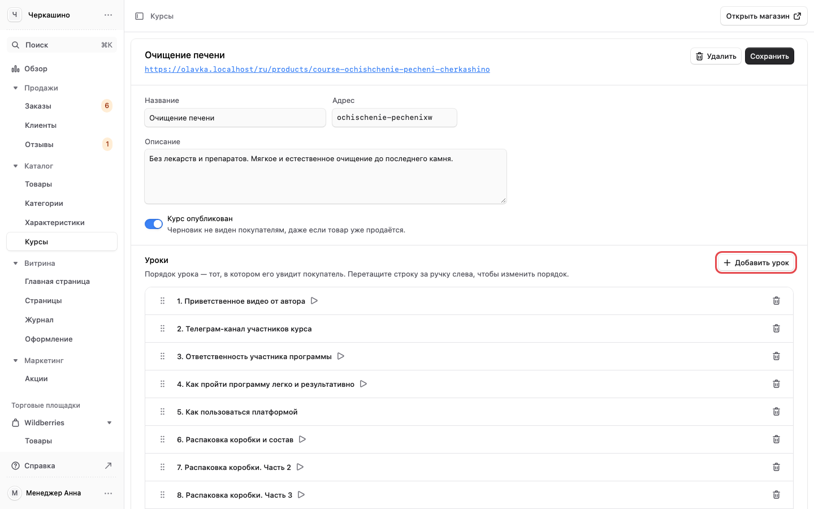
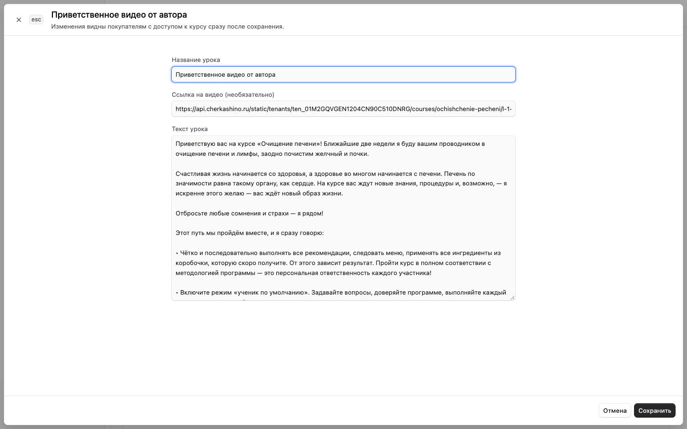
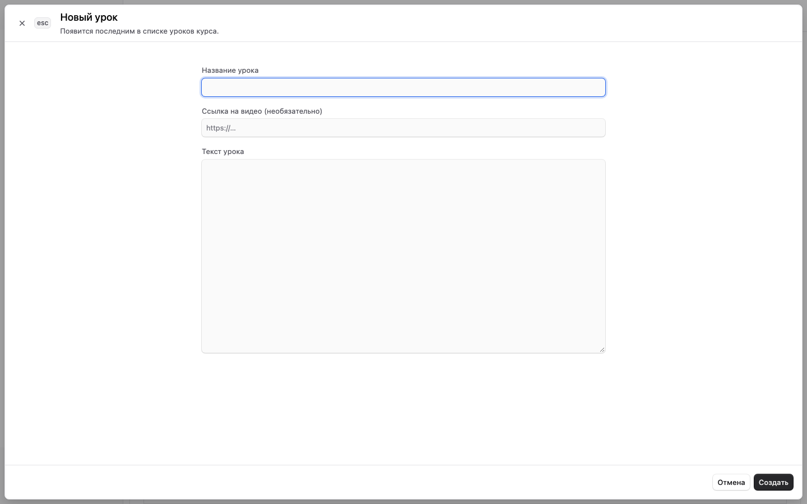
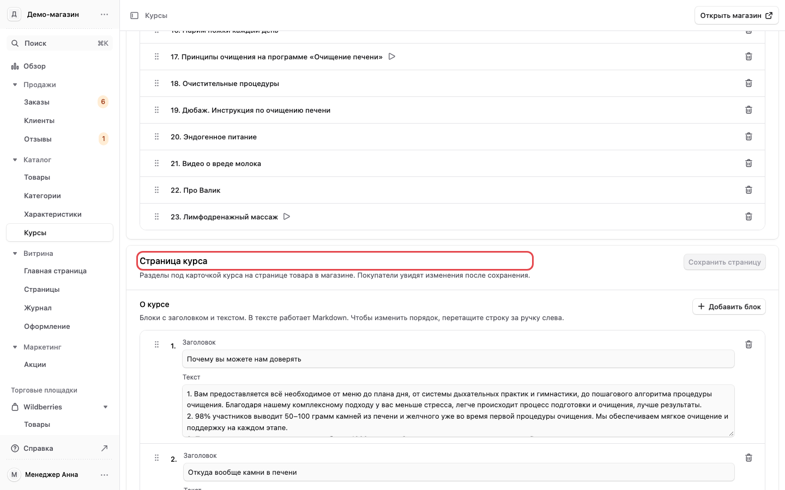

# 5. Курсы: уроки и страница курса

Раздел «Каталог» → «Курсы». Он есть у менеджера и владельца.

Онлайн-курс привязан к товару: покупатель получает доступ к урокам после оплаты этого товара.
Цена курса — это цена товара, она меняется в «Товарах» ([раздел 4](tovary.md)).

## Уроки {#uroki}

1. Откройте курс в списке. Вверху название, адрес страницы курса, описание и переключатель
   «Курс опубликован»: черновик не виден покупателям, даже если товар уже продаётся.
2. Ниже блок «Уроки». Порядок уроков — тот, в котором их увидит покупатель. Чтобы переставить урок,
   перетащите строку за ручку слева.
3. «Добавить урок» — новый урок в конце списка.

## Изменить урок {#urok}

Нажмите урок в списке. Откроется форма:

- **Название урока.**
- **Ссылка на видео** (необязательно). Ссылка начинается с `https://`.
- **Текст урока.**

Нажмите «Сохранить». Изменения видны покупателям с доступом к курсу сразу после сохранения.

Новый урок заполняется так же.

## Страница курса: «О курсе», вопросы, отзывы {#stranica-kursa}

Это разделы под карточкой курса на странице товара в магазине. Они на той же странице курса в
панели, ниже уроков, в блоке «Страница курса».

- **О курсе** — блоки с заголовком и текстом. «Добавить блок» — новый блок.
- **Вопросы и ответы** — «Добавить вопрос».
- **Отзывы** — автор и текст отзыва, «Добавить отзыв».

Порядок блоков меняется перетаскиванием за ручку слева. В тексте работает Markdown: `**жирный**`,
списки через `- `. После правки нажмите «Сохранить страницу». Покупатели увидят изменения после
сохранения.

Обложку курса в панели пока поменять нельзя: для этого напишите в поддержку.
