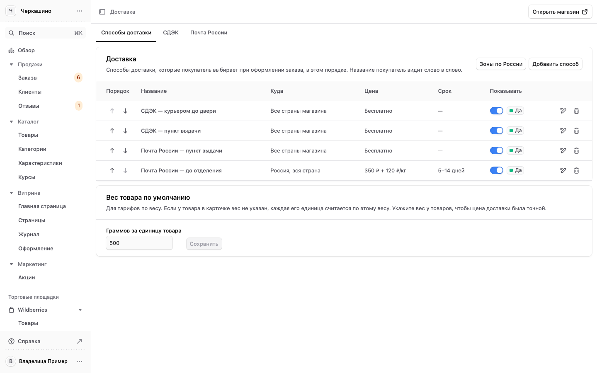
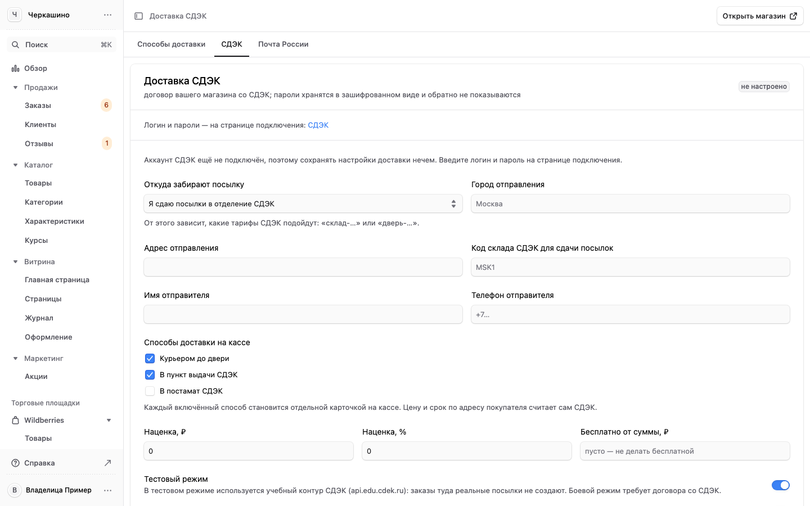
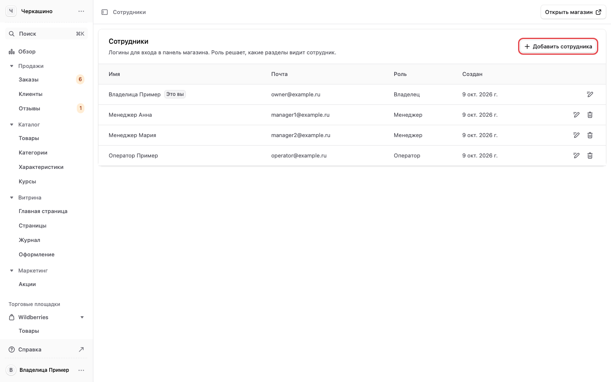
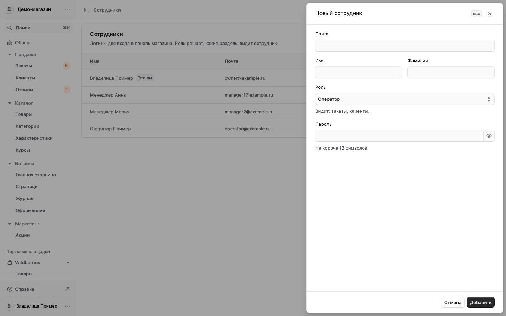
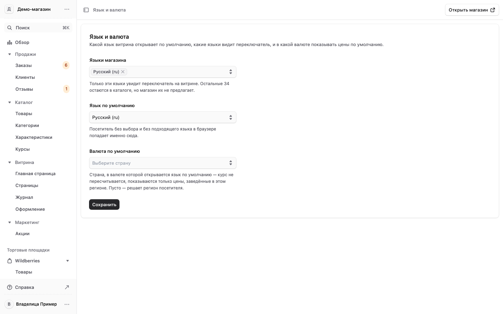
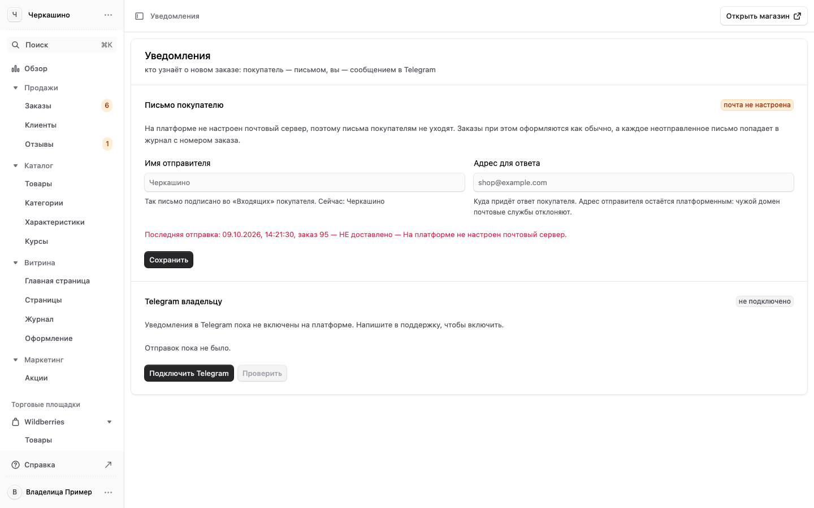

# 7. Настройки: доставка, оплата, реквизиты, сотрудники

Группа «Настройки» в меню есть только у владельца.

## Доставка {#dostavka}

«Настройки» → «Доставка». Вверху вкладки: «Способы доставки», «СДЭК», «Почта России».

На вкладке «Способы доставки» — то, что покупатель выбирает при оформлении заказа, в этом порядке.
Название покупатель видит слово в слово. В строке: куда доставляем, цена, срок, показывать ли способ.
«Добавить способ» — новый способ, например самовывоз. Ниже «Вес товара по умолчанию»: по нему
считается доставка, если у товара в карточке не указан вес.

Вкладка «СДЭК»: откуда забирают посылки (вы сдаёте в отделение или курьер СДЭК забирает у вас),
город и адрес отправления, имя и телефон отправителя, какие способы СДЭК показывать на сайте
(курьером до двери, в пункт выдачи, в постамат). Цену и срок по адресу покупателя считает сам СДЭК,
а ниже можно добавить наценку в рублях или процентах и сумму заказа, от которой доставка бесплатна.
«Тестовый режим» работает с учебным контуром СДЭК: настоящие посылки там не создаются.
Логин и пароли договора со СДЭК вписываются на странице подключения, ссылка на неё — вверху вкладки.

На снимке СДЭК «не настроено»: у учебного магазина нет паролей договора. В вашей панели там
состояние вашего договора.

Вкладка «Почта России» устроена так же.

## Оплата {#oplata}

«Настройки» → «Оплата». Здесь подключена Robokassa.

- «Что видит покупатель» — какие способы оплаты сейчас работают на сайте.
- «Тестовый режим» — покупатель платит тестовой картой Robokassa, деньги не списываются. Боевой режим
  включают только после модерации магазина в Robokassa ([раздел 8](robokassa.md)).
- «Принимать оплату» — показывать ли Robokassa на сайте.
- «Фискализация (чек 54-ФЗ)» — чтобы Robokassa печатала покупателю чек. Для ИП это обязательно:
  включите и укажите систему налогообложения. В личном кабинете Robokassa тоже включите «Робочеки».
- Ниже «Result URL для кабинета Robokassa»: этот адрес вписывают в личном кабинете Robokassa, чтобы
  магазин узнавал об оплате сам.
- Вкладка «Счёт Robokassa» — логин магазина и пароли из личного кабинета Robokassa.

На снимке Result URL учебного магазина. В вашей панели там адрес вашего магазина: его и вписывают в
кабинет Robokassa.

## Реквизиты продавца {#rekvizity}

«Настройки» → «Реквизиты». Эти данные сами подставляются в оферту, политику конфиденциальности,
контакты, возврат и доставку на сайте. Править страницы руками не нужно.

Вверху список «Не заполнено»: каких полей не хватает и на каких страницах они нужны. Пока поле
пустое, блок с ним на сайте скрыт, и покупатель его не видит.

Что заполнить обязательно, чтобы пройти модерацию Robokassa:

1. **E-mail** магазина для покупателей.
2. **Телефон** и кнопка «подтвердить» рядом с ним: без подтверждения номер не выходит в оферту и
   контакты.
3. **Юридический адрес** — для ИП достаточно города.
4. **Адрес возврата** — куда покупатель отправляет возврат, с получателем.

Нажмите «Сохранить» внизу.

На снимке реквизиты условные.

## Сотрудники и роли {#sotrudniki}

«Настройки» → «Сотрудники». Список логинов панели: имя, почта, роль, когда создан. Что видит каждая
роль — [раздел 1](vhod-i-roli.md#roli).

Завести сотрудника:

1. Нажмите «Добавить сотрудника».
2. Впишите почту, имя и фамилию.
3. Выберите роль. Под списком написано, что видит выбранная роль.
4. Задайте пароль не короче 8 символов.
5. Нажмите «Добавить» и передайте почту и пароль сотруднику сами: письмо с паролем панель не
   отправляет.

Изменить и удалить:

- Значок карандаша в строке — сменить имя, роль или пароль. Новая роль действует со следующего
  действия сотрудника, выходить и входить заново не нужно.
- Значок корзины — удалить логин. Он перестаёт работать сразу.
- Себе роль сменить нельзя, себя удалить нельзя. Последнего владельца удалить или понизить нельзя.

## Язык и валюта {#yazyk}

«Настройки» → «Язык и валюта». Какой язык сайт открывает по умолчанию, какие языки видит
переключатель на сайте, в какой валюте показывать цены. Перевод самих товаров —
[раздел 4](tovary.md#perevod).

## Уведомления {#uvedomleniya}

«Настройки» → «Уведомления». Письмо покупателю о заказе: имя отправителя и адрес, куда придёт ответ
покупателя. Ниже уведомления владельцу в Telegram: «Подключить Telegram» и «Проверить». Вверху каждого
блока видно, подключён ли он и когда была последняя отправка. На снимке почта и Telegram не
подключены: это состояние учебного магазина, у вас там своё.

