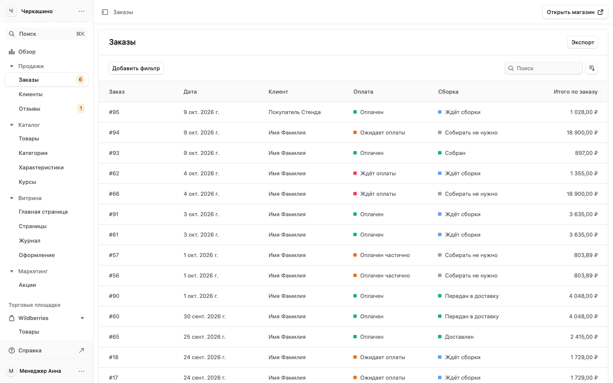
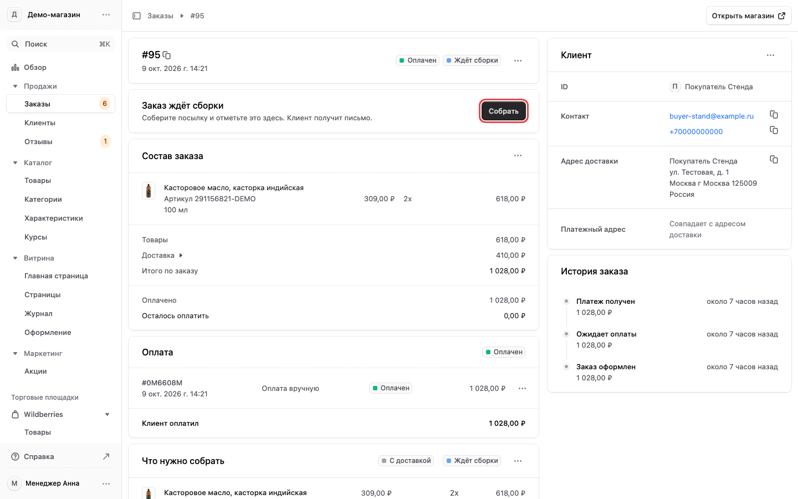
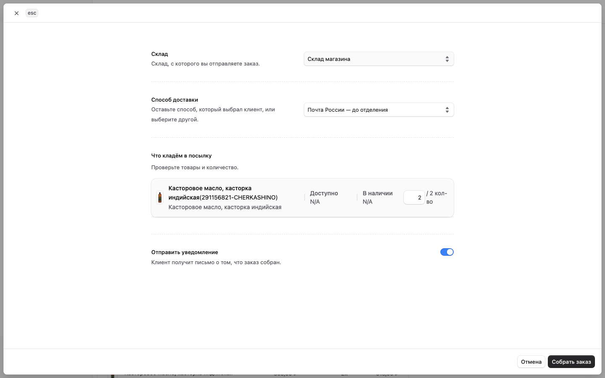
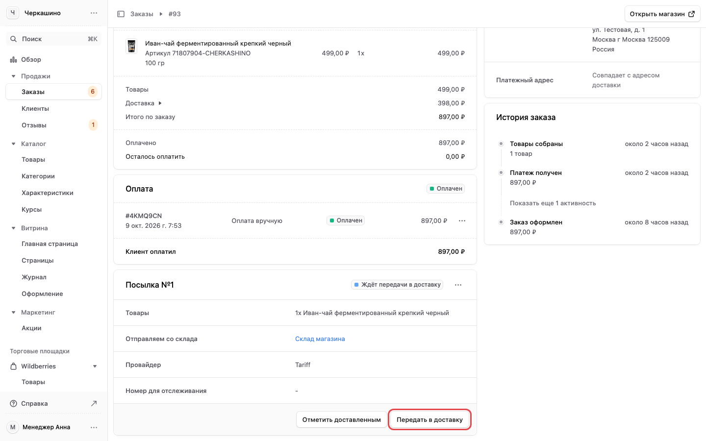
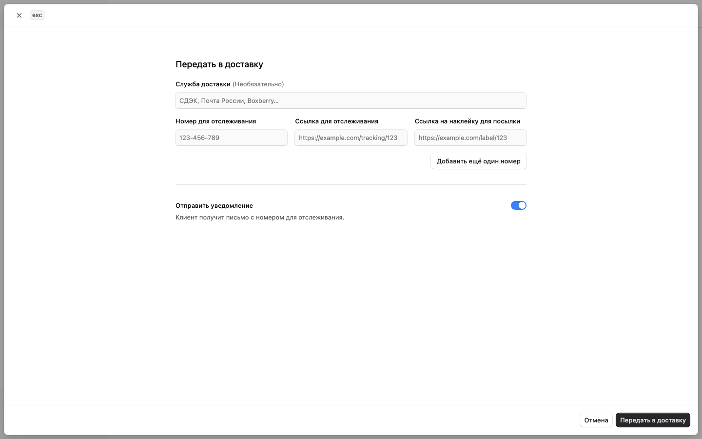
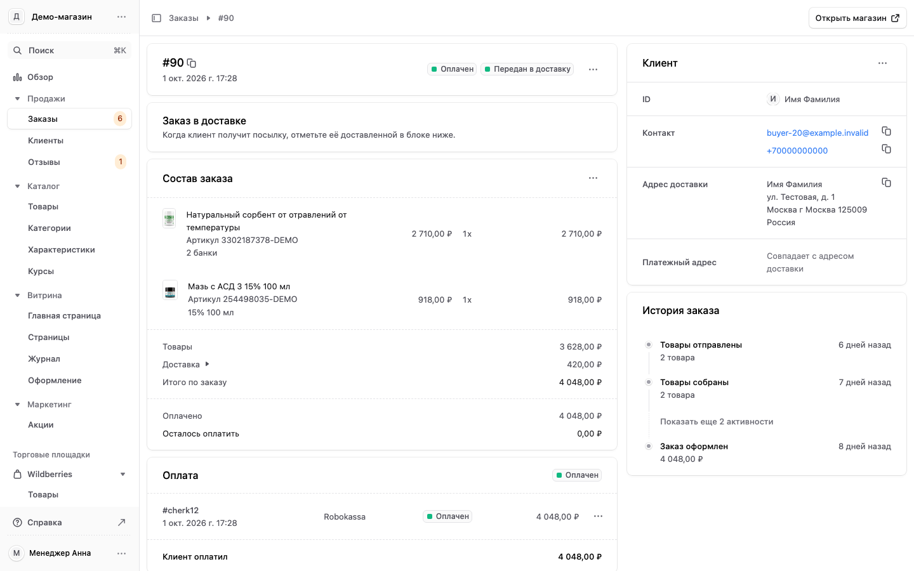
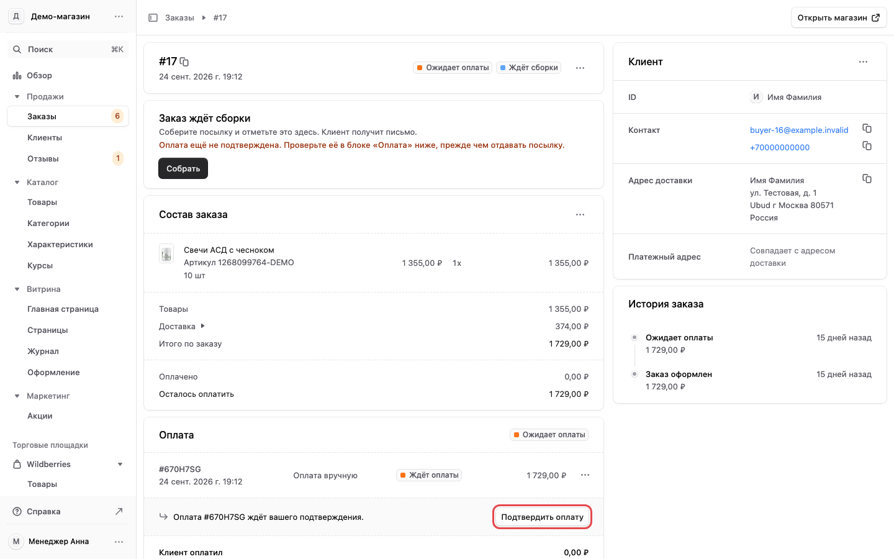
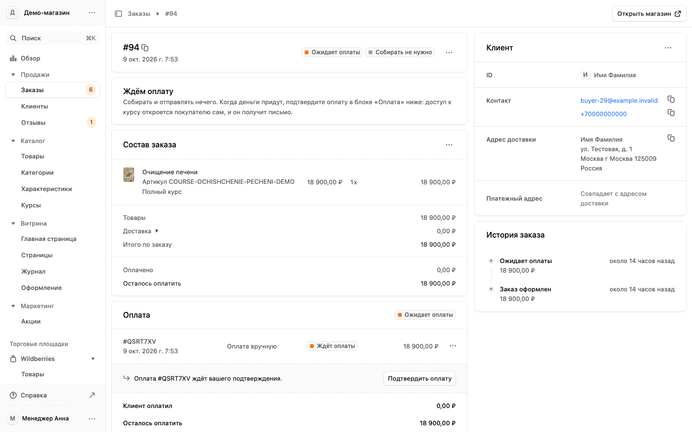

# 2. Заказы: собрать, отправить, подтвердить оплату

Раздел «Продажи» → «Заказы». Он есть у всех ролей.

## Список заказов {#spisok}

Новые заказы сверху. Цифра у пункта «Заказы» в меню — сколько заказов ждут сборки. Колонки: заказ,
дата, клиент, оплата, сборка, итого по заказу. «Добавить фильтр» оставляет, например, только
неоплаченные или только несобранные. Нажмите строку, чтобы открыть заказ.

## Как устроена страница заказа {#stranica-zakaza}

Вверху блок со следующим шагом: что сделать с заказом сейчас и кнопка для этого. Ниже «Состав
заказа», «Оплата», посылки, справа «Клиент» (почта, телефон, адрес доставки) и «История заказа».
Заказ проходит четыре шага: ждёт сборки → собран → в доставке → доставлен.

## 1. Собрать заказ {#sobrat}

1. Откройте заказ. Вверху «Заказ ждёт сборки» и кнопка «Собрать».
2. Если под заголовком красная строка «Оплата ещё не подтверждена», сначала проверьте оплату
   (шаг 4 ниже). Не отдавайте посылку без оплаты.

3. Нажмите «Собрать». Откроется форма. Проверьте склад, способ доставки (тот, что выбрал покупатель)
   и «Что кладём в посылку»: товары и количество.
4. «Отправить уведомление» оставьте включённым: покупатель получит письмо, что заказ собран.
5. Нажмите «Собрать заказ».

Если у магазина подключён СДЭК и покупатель выбрал его, при сборке магазин сам регистрирует посылку в
СДЭК, с товарами из заказа. Вписывать её в личный кабинет СДЭК не нужно.

## 2. Передать в доставку {#peredat-v-dostavku}

1. После сборки вверху заказа «Заказ собран» и кнопка «Передать в доставку».

2. Нажмите её. Впишите службу доставки (СДЭК, Почта России), номер для отслеживания и, если есть,
   ссылку для отслеживания.
3. «Отправить уведомление» оставьте включённым: покупатель получит письмо с номером.
4. Нажмите «Передать в доставку».

## 3. Отметить доставленным {#dostavlen}

Когда покупатель получил посылку, откройте заказ: вверху «Заказ в доставке». В блоке посылки ниже
нажмите «Отметить доставленным». После этого заказ выполнен, делать с ним больше ничего не нужно.

## 4. Подтвердить оплату {#oplata}

Оплата через Robokassa подтверждается сама: в блоке «Оплата» стоит «Оплачен».

Если покупатель платил переводом по реквизитам или оплата ждёт подтверждения, в блоке «Оплата» стоит
«Ожидает оплаты» и строка «Оплата … ждёт вашего подтверждения». Проверьте, что деньги пришли, и
нажмите «Подтвердить оплату». Пока оплата не подтверждена, заказ не собирайте.

## Заказ онлайн-курса {#kurs}

Курс собирать и отправлять не нужно. Вверху заказа «Ждём оплату». Когда оплата подтверждена,
доступ к курсу откроется покупателю сам, и он получит письмо. Если оплата пришла не через Robokassa,
подтвердите её в блоке «Оплата», как в шаге 4.

## Отменить заказ {#otmenit}

Кнопка «…» в правом верхнем углу блока с номером заказа → «Отмена», затем подтвердите. Вернуть
отменённый заказ нельзя, а отправленный заказ отменить нельзя.
